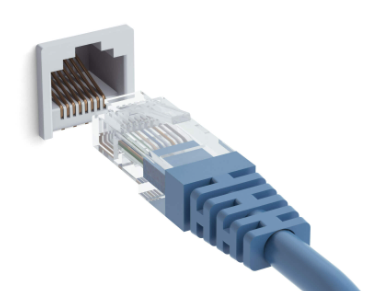

UDP is the network protocol that carries the data between AgOpenWeb and your
boards. It uses standard Ethernet cables and is highly resilient to
interruption (unlike USB, which can get upset if the connection drops and
comes back).

Your tablet and your board will need the usual Ethernet connections you see
around the house (in your router, the back of your smart TV and so on), similar
to this:

You can think of UDP as passing a message to a friend on a postcard: anyone can
read it, and you have no way of knowing if it was delivered. For guidance this
is ideal. The data does not leave the tractor, so security is not much of a
worry, and any program on the network being able to read it is a good thing.

The modules listen on port **8888**, and AgOpenWeb listens on port **9999**.
Only one program on a computer can listen on 9999, so close AgIO and AgOpenGPS
before you start AgOpenWeb on the same computer.

The modules must reach AgOpenWeb by cable, not over Wi-Fi: see
[What you need](/software/what-you-need/#an-ethernet-cable-to-the-modules). To
see which modules answer, and to put them on the right subnet, see
[Network IO](/software/connect/network-io/).
