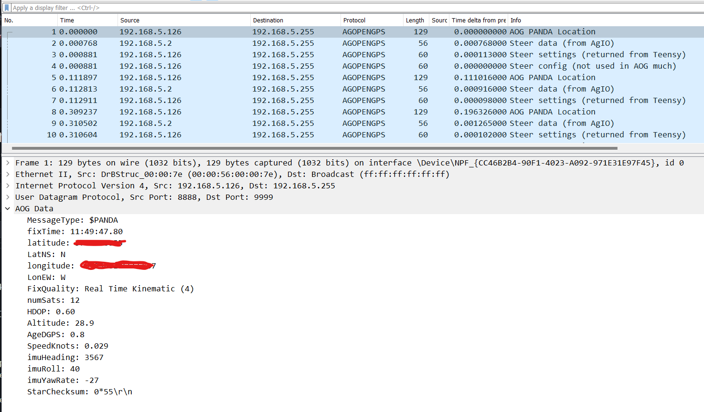

#### Message formats

PGNs are described here:
https://github.com/AgOpenGPS-Official/Boards/blob/main/PGN.md

Based on the PGNs one can create modules for the Steering, GPS, Machine, IMU,
etc.

To see which modules answer, and to put them on the same subnet as the
computer, see [Network IO](/software/connect/network-io/).

If you are debugging in Wireshark, there's a work-in-progress protocol decoder
available here:
https://github.com/lansalot/AgOpenGPS-Tools/tree/main/Network%20Analysis

Just download and save in your Wireshark plugins folder (not any subfolders, eg
4.0). Please report any issues either on that AgOpenGPS-Tools repo, or to
andyinv on the forums or Telegram.
