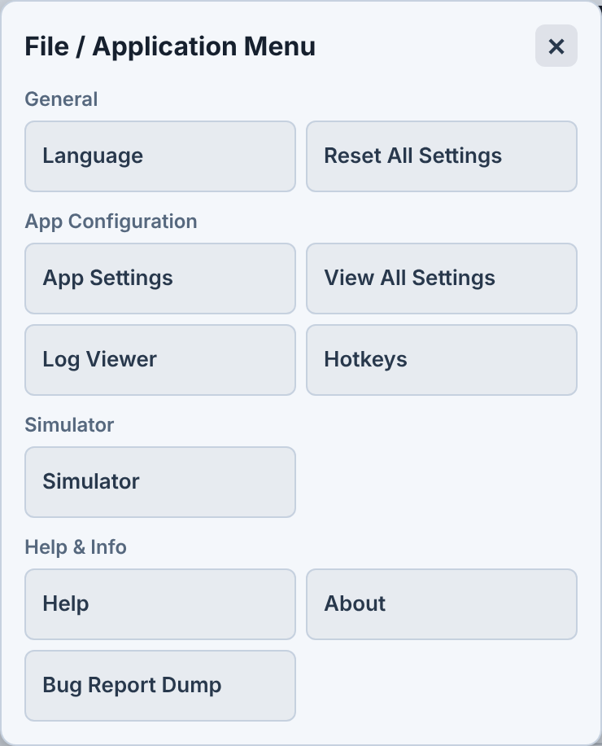
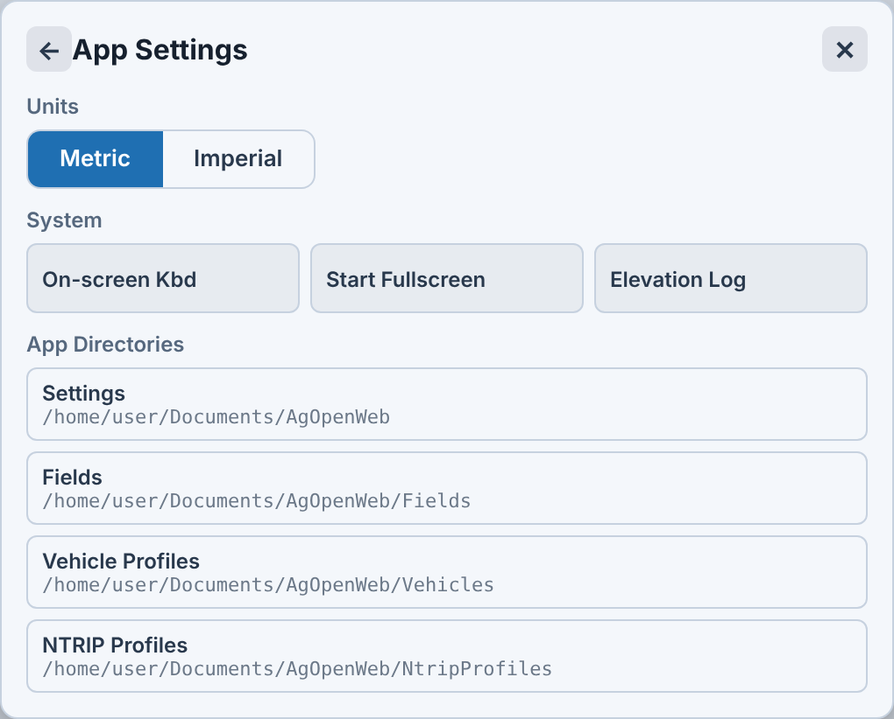
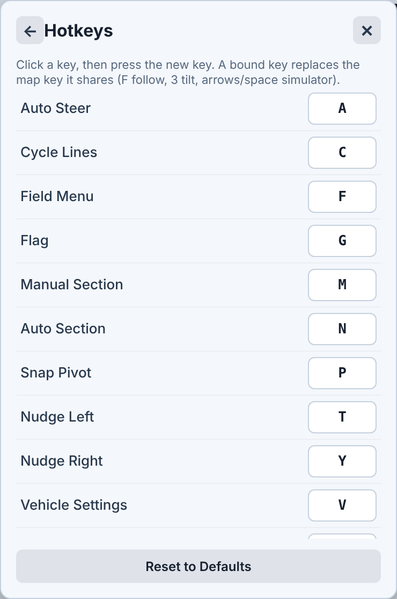

These are all in the **File menu**, the first button on the left bar. The
settings here belong to AgOpenWeb itself, not to a vehicle: they stay the same
whichever profile is loaded, and every screen connected to it uses them.

| Button             | What it opens                                                                    |
| ------------------ | -------------------------------------------------------------------------------- |
| Language           | The language of the screens                                                      |
| Reset All Settings | Puts the app's settings back as they were at the first start                     |
| App Settings       | Units, the on-screen keyboard, full screen, the elevation log, the app's folders |
| View All Settings  | Every setting in use, to read                                                    |
| Log Viewer         | What the app has been doing                                                      |
| Hotkeys            | The keyboard shortcuts                                                           |
| Simulator          | Shows or hides the simulator                                                     |
| Help and About     | Links to the project, and the version you have                                   |
| Bug Report Dump    | A report of a problem for the maintainers                                        |

The Log Viewer and the bug report are on
[Charts, logs and bug reports](/software/charts-logs-bug-reports/), and the
simulator on [Try it with the simulator](/software/simulator/).

## Language

Tap a language and every screen changes to it at once. Volunteers translate
AgOpenWeb, so a language may not be complete yet: a text not translated shows
in English.

## Reset All Settings

Puts the app's own settings back as they were at the first start: the
language, the units and the rest of **App Settings**, the hotkeys, the map and
sound settings of **Screen & Alerts**, and more. It asks first, and cannot be
undone.

Your vehicle, tool and NTRIP profiles and your fields are files of their own,
and are not deleted.

## App Settings

**Units**: **Metric** or **Imperial**, for every figure on the screens.

**System**:

- **On-screen Kbd**: AgOpenWeb's own keyboard comes up when you tap a box to
  type in, with a number pad for numbers. **#+=** gives the symbols for web
  addresses and passwords. Use it on a touch screen with no keyboard, or where
  the tablet's own keyboard covers the screen.
- **Start Fullscreen**: the AgOpenWeb window on a computer opens full screen
  instead of as a big window.
- **Elevation Log**: while a field is open, saves the height of the ground
  (the GPS height less the antenna height) every 2.9 m into `elevation.csv` in
  the field's folder, with the position, fix quality, heading and roll. Other
  programs can make a height map of the field from it.

**App Directories** shows where AgOpenWeb keeps its settings, fields, vehicle
profiles and NTRIP profiles. A folder that does not exist yet is marked
**(missing)**.

## View All Settings

Every setting in use, in groups: Vehicle, GPS, Roll, Tool, U-Turn, Tram,
Machine, Display and AutoSteer. You can only read them here. It is a quick way
to check a value, or to show your settings when you ask for help.

## Hotkeys

With a keyboard, a key can do the work of a button.

To change one, click its key, then press the new key. **Esc** stops without a
change. **Reset to Defaults** puts back the keys below.

| Key    | Does                                             |
| ------ | ------------------------------------------------ |
| A      | AutoSteer on or off                              |
| C      | Cycle Lines: the next guidance line              |
| F      | Field Menu: opens Field Operations               |
| G      | Flag: a flag at the tractor                      |
| M      | Manual Section: **Manual sections** on or off    |
| N      | Auto Section: **Auto sections** on or off        |
| P      | Snap Pivot: moves the line to the tractor        |
| T      | Nudge Left                                       |
| Y      | Nudge Right                                      |
| V      | Vehicle Settings: opens Vehicle & Tool           |
| W      | Steer Wizard                                     |
| 1 to 8 | Section 1 to 8, as a tap on the section's button |

- Hotkeys do nothing while you type in a box, while a question, the Steer
  Wizard or the Hotkeys panel is open. Those that switch something do nothing
  on a screen that does not have control.
- Holding a key down counts once.
- The map has keys of its own: **[** and **]** tilt the map, and the arrow keys
  and the space bar drive the simulator. A hotkey on the same key takes its
  place. That is why **F** (follow the tractor) and **3** (tilt) work on the
  map only once you move the **Field Menu** and **Section 3** hotkeys to other
  keys.

## Help and About

**Help** has links to the AgOpenWeb project on GitHub, its discussion forum,
the releases page to look for a newer version, and tutorial videos on YouTube.

**About** shows the version you have and its build. Give both when you report a
problem.
