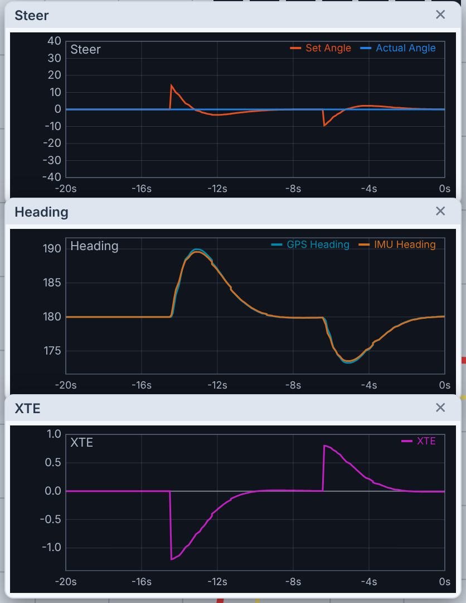
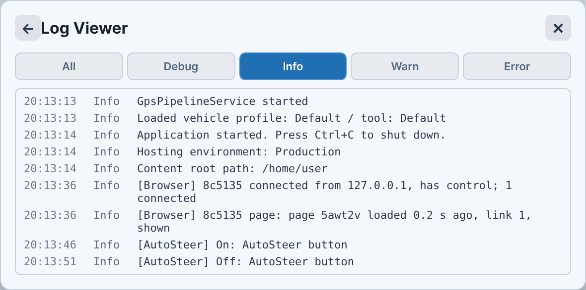
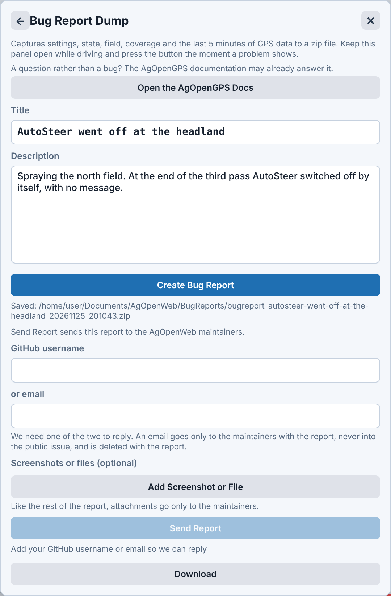

When something is not right, three tools help you see why: live charts of the
steering, the app's log, and a bug report.

## Charts

Open **Tools** on the left bar. Under **Diagnostic Charts** are three charts:

- **Steer Chart**: **Set Angle** is the steering angle AutoSteer asks for, and
  **Actual Angle** is what the steering sensor reads. The scale is fixed at 40°
  each side.
- **Heading Chart**: the heading from the GPS and from the IMU. Without an IMU,
  only the GPS line is drawn.
- **XTE Chart**: the distance from the guidance line (the cross-track error),
  in your length unit.

Each chart shows the last 20 seconds, the newest on the right. The app keeps
collecting while a chart is closed, so a chart you open after something
happened still shows it.

The charts float over the map. Drag one by its title to move it. Tap its **✕**,
or its button in **Tools** again, to close it.

When the steering is tuned well, **Actual Angle** follows **Set Angle** closely
and the XTE stays near 0. What to change when it does not is in
[AutoSteer settings](/software/setup/autosteer/#where-to-start-when-tuning).

**Actual Angle** comes from the steer module. The simulator does not steer the
module, so there the line does not follow **Set Angle**.

## Log Viewer

The log is what the app writes down as it works: when it started, each screen
that connects or leaves, AutoSteer going on and off and why, warnings about the
GPS data, and errors.

Open the **File menu**, or **Tools**, and tap **Log Viewer**.

The newest line is at the bottom. The buttons choose how much you see: **All**,
**Debug**, **Info**, **Warn** or **Error**. Each one shows its own level and the
more serious ones, so **Warn** shows warnings and errors.

The viewer shows the last 200 lines. A bug report holds more: the last 2000.

## Bug report

A bug report is a zip file of one moment. It holds the settings, the state of
the app, the open field and the job's coverage, the last 5 minutes of GPS data,
the log, and facts about the device and about each screen connected to it.
With NTRIP in use, it also holds what the correction connection did.

Open the **File menu**, then **Bug Report Dump**.

### Make it at the moment

If something goes wrong while you drive, keep this panel open and tap
**Create Bug Report** as soon as you see it, while the last minutes are still
in the report. A title is not needed for this.

The line under the button says where the zip was saved: the `BugReports` folder
in the AgOpenWeb data folder.

### Send it

**Send Report** sends the zip to the AgOpenWeb maintainers, who open an issue
for it on GitHub. It can be sent once:

- the **Title** has at least 15 characters and the **Description** at least 40.
  Say what you were doing, what happened, and what you expected instead.
- there is a **GitHub username** or an **email**, so the maintainers can reply
  to you. The device remembers them for the next report.

Until then, the line under **Send Report** says what is missing. You can write
the title and description after **Create Bug Report**, before you send.

**Add Screenshot or File** adds pictures or other files to the report: up to
10, 20 MB each and 25 MB in all.

The GitHub issue is public. It shows the title, the description, the app
version, the operating system and the language, and your GitHub username if
you gave one. Do not write anything private in the title or description.
The zip, the files you added and your email go only to the maintainers, and
the email is deleted with the report.

Without a connection, the report waits and sends itself when the device is
back online. When the panel says **Sent as issue #…**, **Open Issue** opens it
on GitHub.

### Keep a copy

**Download** saves the zip on the device you are using, in its downloads
folder. You can then share it yourself, for example on
[Discourse](https://discourse.agopengps.com).
