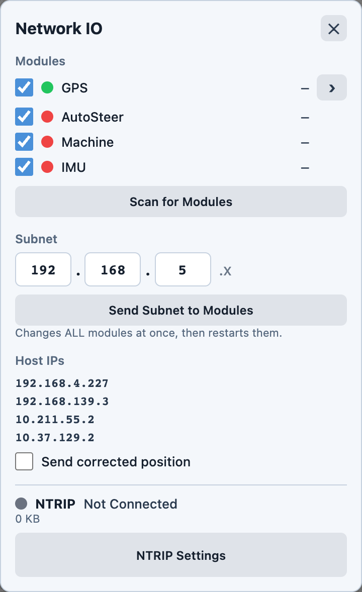

**Network IO** is the last button on the left bar. It does the job AgIO does in
AgOpenGPS: it shows the modules on the network and the state of the RTK
corrections.

## Modules

There is one row for each kind of module: **GPS**, **AutoSteer**, **Machine**
and **IMU**.

- **The tick box** says whether you have this module. Untick the ones you do
  not have, so that a module you never fitted is not shown as a fault.
- **The dot** is green when the module is sending data, red when you have
  ticked it but nothing arrives from it, and grey when it is not ticked.
- **The address** is the module's network address.
- **›** on the GPS row opens [System Data](/software/connect/system-data/).

**Scan for Modules** asks every module on the network to answer, and fills in
their addresses.

:::note
With the simulator on, the GPS dot is green though no receiver is connected:
the simulator is supplying the position.
:::

## Subnet

The modules and the computer that runs AgOpenWeb must be on the same subnet:
the first three numbers of their network addresses must match. The modules
ship on `192.168.5.x`.

**Host IPs** lists the addresses of the computer that runs AgOpenWeb. If none
of them starts with the modules' three numbers, the modules can answer a scan
but their data never arrives. The panel then tells you so, for example:

> The modules are on 192.168.5.x, this device is on 192.168.1.x. Send moves
> the modules to 192.168.1.x.

You have two ways to put it right:

- **Change the computer.** Give its Ethernet port a fixed address on the
  modules' subnet, such as `192.168.5.10`. This is done in the settings of
  Windows, macOS, Linux or Android, not in AgOpenWeb.
- **Change the modules.** Type the three numbers of the subnet you want and tap
  **Send Subnet to Modules**. AgOpenWeb asks you to confirm.

:::caution
**Send Subnet to Modules** changes every connected module at once and restarts
them. Do it with the tractor stopped.
:::

## Send corrected position

Tick this only if another device on the network needs the position AgOpenWeb
has worked out: a seed monitor, a rate controller or a GPS output module. It
sends the position, speed, heading and fix quality on every fix.

## NTRIP

The lower part of the panel shows whether RTK corrections are arriving, how
much has been received, and where it is sent. **NTRIP Settings** opens the
rest: see [RTK corrections (NTRIP)](/software/connect/ntrip/).

## When a module stays red

- Check its power, and that its Ethernet cable is plugged in at both ends.
- Tap **Scan for Modules**. If an address appears but the dot stays red, the
  subnet is wrong: see above.
- On Windows, check that the modules' network is set to **Private**. A network
  with no internet, such as a cab router, often comes up as **Public**, and when
  Windows first asked whether to allow AgOpenWeb, it ticked private networks
  only. On a Public network Windows then blocks what the modules send, and their
  dots stay red. In **Settings › Network & internet**, open **Ethernet**,
  choose the network, and set **Network profile type** to **Private**.
- If the tablet is cabled to the modules' router and has also joined that
  router's Wi-Fi, turn its Wi-Fi off. See
  [What you need](/software/what-you-need/#an-ethernet-cable-to-the-modules).
- Only one program can listen to the modules at a time. Close AgOpenGPS and
  AgIO if they are running on the same computer.
