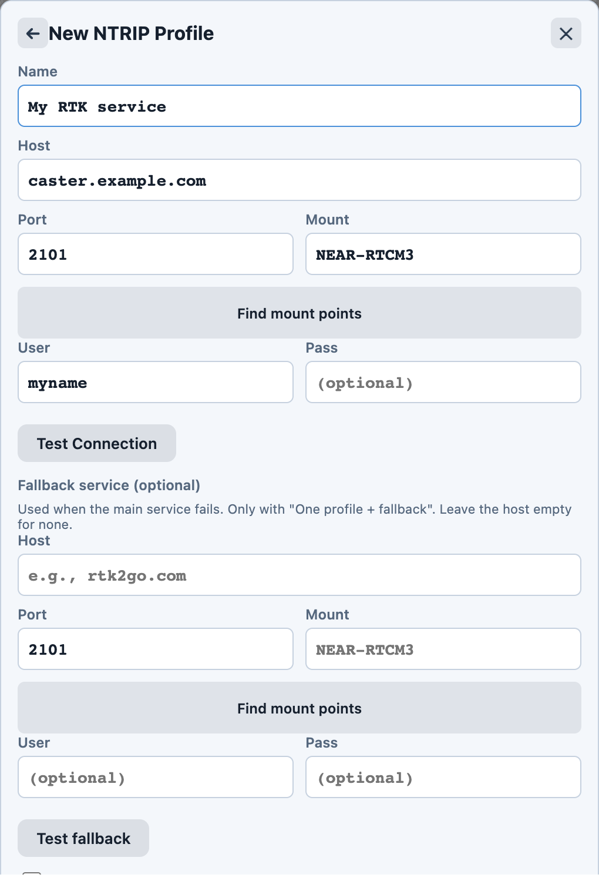
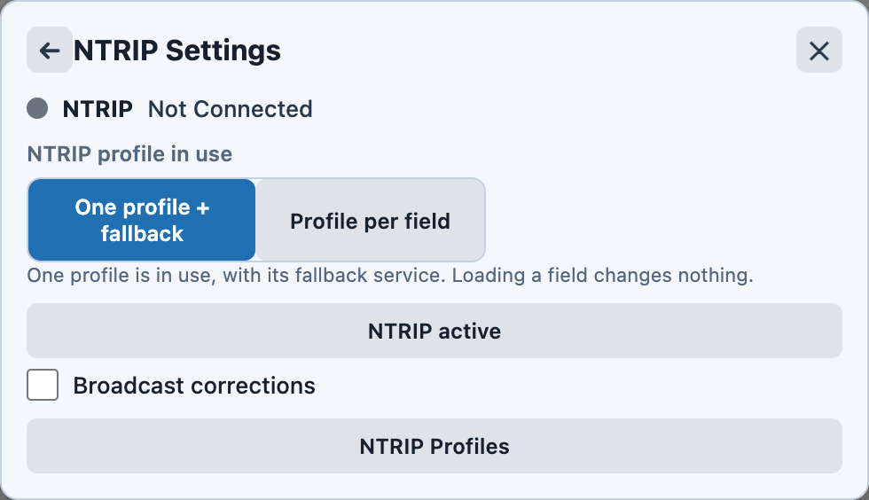

RTK needs corrections from a base station. Most people get them over the
internet from a service called an NTRIP caster. AgOpenWeb fetches them and
passes them to your GPS receiver.

You need:

- an internet connection on the computer that runs AgOpenWeb (Wi-Fi or a
  phone's hotspot is fine for this),
- the details from your correction service: host, port, mount point, and the
  user name and password if it has them.

If you used AgIO, your caster is copied across for you: see
[Moving from AgOpenGPS](/software/moving-from-agopengps/).

## Add your service

1. Open **Network IO**, then **NTRIP Settings**, then **NTRIP Profiles**.
2. Tap **+**.
3. Fill in **Name** (anything you like), **Host**, **Port** and **Mount**, and
   **User** and **Pass** if your service needs them.

   

4. Tap **Test Connection**. The line beside it says whether the service
   answered.
5. Tick **Set as default profile**, then **Save Profile**.

AgOpenWeb connects at once with a new default profile.

**Find mount points** asks the caster for its list, so you can pick one instead
of typing it. The list says which mount points need your position.

:::note
The mount point must be typed exactly. Capitals matter.
:::

## The profile list

| Button  | What it does                          |
| ------- | ------------------------------------- |
| **+**   | Add a profile                         |
| **⚙**   | Edit the selected profile             |
| **✕**   | Delete the selected profile           |
| **Use** | Connect with the selected profile now |
| **★**   | Make the selected profile the default |

## NTRIP Settings

- **NTRIP active / NTRIP disabled.** Tap to switch the corrections off, for
  work where there is no mobile coverage, and on again.
- **One profile + fallback** or **Profile per field.** See the next two
  headings.
- **Broadcast corrections.** Normally the corrections go straight to the GPS
  module. Tick this to send them to every device on the module network.
  Leave it off unless something else there needs them.

While connected, the panel also shows a list of **Checks** (connected, logged
in, mount point found, corrections arriving, base station position received,
correction age) and a table of the correction messages the service sends.

## A fallback service

With **One profile + fallback**, one profile is used everywhere and opening a
field changes nothing. That profile can name a second service to use when the
first fails.

In the profile, fill in **Fallback service** the same way as the main one, and
test it with **Test fallback**.

- With **Switch to the fallback by itself when the main service fails** ticked,
  AgOpenWeb switches after the number of failed attempts you set. A wrong login
  or mount point switches at once.
- Without it, you switch by hand with **Switch to fallback** on the Network IO
  panel.

AgOpenWeb **never switches back by itself**. When the main service answers
again, it tells you, and you choose when to go back with **Switch to main**.

:::caution
Every switch may cost you RTK for a moment, and the position may shift a
little, because the corrections now come from a different base. Switch at the
headland, not in the middle of a pass.
:::

## A profile for each field

With **Profile per field**, opening a field connects with the profile that
field belongs to. Use it when your fields are served by different base
stations.

In each profile, tick the fields under **Associated Fields** and tick
**Auto-connect when associated field is loaded**. Fields that belong to no
profile use the default one. The fallback service is not used in this mode.

## What the status says

The NTRIP line on Network IO and in NTRIP Settings shows one of these:

| Status                             | What to do                                                                                   |
| ---------------------------------- | -------------------------------------------------------------------------------------------- |
| Corrections arriving               | Nothing. All is well                                                                         |
| Corrections arriving (fallback)    | The fallback service is in use                                                               |
| Connecting…                        | Wait                                                                                         |
| Connected, waiting for corrections | Wait a few seconds                                                                           |
| Off                                | NTRIP is disabled. Switch it on in NTRIP Settings                                            |
| Login refused                      | Check the user name and password. Some services answer like this for a wrong mount point too |
| Mount point not found              | Check the mount point. Capitals matter                                                       |
| Service is busy                    | The service is busy or starting up, or your login is already in use on another device        |
| Cannot reach the service           | Check the host, the port and the internet connection                                         |
| No network                         | The computer has no network connection                                                       |
| Connected, but no corrections      | Some services need your position first: check that the GPS has one                           |
| Corrections stopped                | The connection dropped. AgOpenWeb tries again by itself                                      |
| Service not understood             | Check the host, port and mount point                                                         |

After a failure AgOpenWeb tries again by itself, after 1, 2, 4, 8 and then
every 15 seconds. A wrong login or mount point will not come right by
itself: correct the profile.

## Corrections arrive but there is no RTK

Look at the line **Receiver: …, correction age … s** on Network IO.

- **The correction age keeps climbing.** The corrections are not reaching the
  receiver. Check that the GPS dot is green and that the panel says where the
  corrections are sent.
- **The age is low but the fix stays at Float or lower.** The receiver has the
  corrections but cannot use them yet. Check its view of the sky, the antenna
  cable, and that the base station is not too far away.
- **"No base position from the caster."** The mount point is not sending the
  base station's position, and the receiver cannot reach RTK without it. Try
  another mount point or ask your service.
