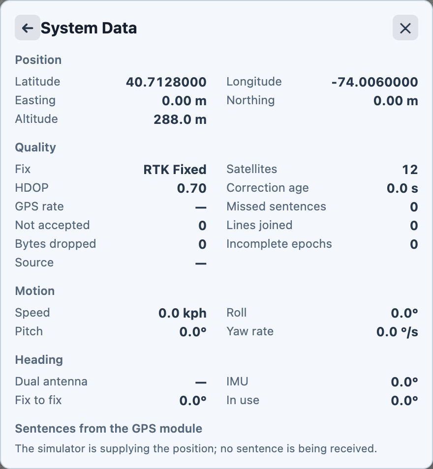

**System Data** shows what AgOpenWeb is getting from the GPS, in detail. Open
it from **Network IO** with the **›** at the end of the GPS row.

It is the place to look when the position jumps, the heading is wrong, or RTK
will not come.

## Position

Latitude, longitude and altitude as the receiver gives them. **Easting** and
**Northing** are the position in metres, east and north of the field's origin.

## Quality

| Row               | What it tells you                                                                                                                           |
| ----------------- | ------------------------------------------------------------------------------------------------------------------------------------------- |
| Fix               | The fix quality, such as _RTK Fixed_ or _RTK Float_                                                                                         |
| Satellites        | How many satellites are in use                                                                                                              |
| HDOP              | How well the satellites are spread across the sky. Lower is better                                                                          |
| Correction age    | How old the RTK corrections are, in seconds. A few seconds is normal; a number that keeps climbing means they are not reaching the receiver |
| GPS rate          | Positions per second. 10 is usual                                                                                                           |
| Missed sentences  | Positions that should have come and did not                                                                                                 |
| Not accepted      | Lines AgOpenWeb refused: a failed checksum (damaged on the way) or a sentence it does not read                                              |
| Lines joined      | Lines a bridge board cut in two, which AgOpenWeb put back together. It works, but the board should not do it                                |
| Bytes dropped     | Data in the GPS stream that belonged to no line                                                                                             |
| Incomplete epochs | Positions that arrived with one of their sentences missing                                                                                  |
| Source            | The network address the position comes from                                                                                                 |

On a healthy link the counters from **Missed sentences** down stay at 0, or
rise only now and then. Counters that climb steadily point at the cable, the
board or the receiver's settings, not at AgOpenWeb.

## Motion

Speed, roll, pitch and the rate of turn. Park on level ground: **Roll** should
read close to 0. If it does not, see
[Vehicle, the Roll tab](/software/setup/vehicle/#roll-tab).

## Heading

AgOpenWeb can take the heading from three places. This part shows each one
separately, and the one being used:

| Row          | Where it comes from                                       |
| ------------ | --------------------------------------------------------- |
| Dual antenna | The two antennas of a dual receiver                       |
| IMU          | The IMU                                                   |
| Fix to fix   | The direction from one position to the next, while moving |
| In use       | The heading AgOpenWeb steers by                           |

Drive straight and compare them. A source that disagrees with the others by a
steady amount usually has an offset to set or a sensor mounted the wrong way
round.

## Sentences from the GPS module

The last sentence of each kind, exactly as it arrived, with how long ago. With
the simulator on there are none, and the panel says so.
