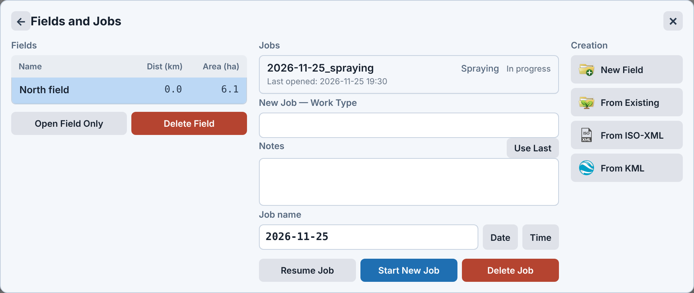
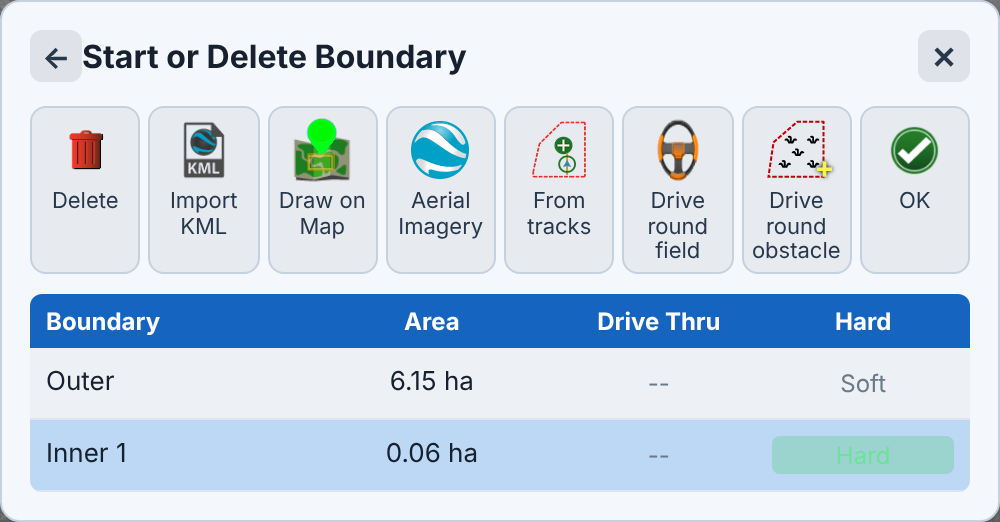

Everything AgOpenWeb knows about a piece of ground is kept with its **field**:
the boundary, the obstacles, the headland, the guidance lines, the flags, and
the worked area of each job. Fields are folders in `Fields`, in the AgOpenWeb
data folder.

## Fields and jobs

A **field** is the ground itself. A **job** is one piece of work in it, such as
a spraying or a drilling. Each job keeps its own worked area, so the next
spraying of the same field starts with a clean map, and the last one is still
there.

**Field Operations**, the sixth button on the left bar, opens:

| Button          | What it does                                                                          |
| --------------- | ------------------------------------------------------------------------------------- |
| Fields and Jobs | The list of fields and their jobs, and the buttons to make a field                    |
| Resume Last Job | Opens the field and the job you worked in last                                        |
| Resume Job      | A list of the recent jobs in every field                                              |
| Drive In        | Opens the field whose starting point is within 0.5 km of you. If several are, it asks |
| Close           | Closes the field                                                                      |

### Start or resume a job

1. Tap **Fields and Jobs** and choose the field on the left.
2. For new work, type the **Work Type**, such as _Spraying_, and any notes.
   The **Job name** starts as today's date. Tap **Start New Job**.
3. To go on with earlier work, choose the job under **Jobs** and tap **Resume
   Job**.

**Open Field Only** opens the field with no job, which is handy for making a
boundary or a guidance line. If you work the ground like that, closing the
field asks whether to **Save to Job**, which makes a new job named by the date,
or **Discard** the worked area.

**Delete Field** deletes the field with all its jobs, and **Delete Job** one
job. Close the field, or the job, first.

### Make a field

The buttons under **Creation**:

- **New Field**: type a name and tap **Create Field**. The field is made where
  the tractor is, so do it with a GPS position, in the field or close to it.
  Without one, the panel says so and uses a default place.
- **From Existing**: a copy of another field, with its boundary. Choose what
  else comes with it: **Flags**, **Mapping** (the worked area), **Headland**
  and **Lines**.
- **From KML** and **From ISO-XML**: from a file you have put in the `Import`
  folder, next to `Fields`. In a KML file, the first shape becomes the
  boundary and any others become obstacles.

Fields from AgOpenGPS can be copied across: see
[Moving from AgOpenGPS](/software/moving-from-agopengps/).

## The boundary

The boundary is the edge of the field. Section control uses it to keep the
tool off outside the field, the headland and the U-turns are built from it, and
[GeoStop](/software/setup/machine-module/#pin-config) watches it. A field with
no boundary still works, but only the worked area decides the sections, and
there are no automatic U-turns.

Open **Field Tools** on the left bar, then **Boundary**.

| Button               | What it does                                                                                    |
| -------------------- | ----------------------------------------------------------------------------------------------- |
| Delete               | Deletes the boundary chosen in the list, after asking                                           |
| Import KML           | Takes the boundary from a KML or KMZ file in the `Import` folder. Other shapes become obstacles |
| Draw on Map          | Shows the aerial imagery. Tap the corners of the field, then **Finish**                         |
| Aerial Imagery       | Fetches the aerial picture of the field for the map background. Needs the internet              |
| From tracks          | Makes the boundary where your guidance lines cross. It needs at least two                       |
| Drive round field    | Records the boundary as you drive round the edge                                                |
| Drive round obstacle | Records an obstacle as you drive round it                                                       |

If the field has a boundary already, **Import KML**, **Draw on Map**, **From
tracks** and **Drive round field** ask before they replace it. The obstacles
stay.

### Drive round the field

1. Tap **Drive round field** (the steering wheel). **Record Field Boundary**
   opens.
2. Choose where the line is recorded:
   - **At the tool**: at the outer end of the tool, on the side you choose.
   - **At the antenna**: at the antenna, moved sideways by the **Recording
     Offset** (in cm).
   - **Left side** or **Right side**: the side of the tractor the edge is on.
3. Tap **Record** and drive round the field. A point is added about every
   metre. **Pause** stops the recording for a moment, for example to go round
   a tree that is not part of the edge.
4. Back where you started, tap **Stop and save**. The two ends are joined.

**Add point** adds one where you are now, and **Delete last point** takes the
last one away. With **Section control** on, points are recorded only while the
sections are working, so the edge follows the work. AgOpenWeb remembers these
choices for the next recording.

:::caution
For an obstacle, use **Drive round obstacle**, the button with the **+**.
**Drive round field** replaces the field's boundary.
:::

### Obstacles

An obstacle is a place inside the field that is not worked: a pond, a group of
trees, a pylon, a wet hole. Record it with **Drive round obstacle** in the same
way. The field needs its boundary first.

The sections are always off over an obstacle. In the list, tap an obstacle's
cells to change it:

- **Drive Thru**: a U-turn may cross it, such as a track across a ditch. The
  sections still go off over it.
- **Hard**: the tool must stay clear of it during a U-turn. On a **Soft** one
  the end of the tool may swing over it. The field's own boundary can be hard
  too. See [U-turns](/software/u-turns/#soft-and-hard-boundaries).

### When the boundary changes

When you replace or delete the field's boundary, a headland made from the whole
boundary is rebuilt at the same distance on the new one. Headland lines and
curves drawn on the old boundary are removed, so draw them again. Tram lines
are rebuilt.

## The headland

The headland is the strip round the edge where you turn. It is used for:

- **Section control**: the sections go off in it, when **Headland on/off** and
  **Section control in headland** are both on in the field bar. See
  [Section control](/software/section-control/#the-headland).
- **The hydraulic lift** of the
  [machine module](/software/setup/machine-module/#hydraulic-lift), which
  raises the tool as you come into it.

The U-turns have a line of their own, set by **Distance from boundary** on the
tool's U-Turn tab.

### Make the headland

Open **Field Tools**, **Field Builder**, then the **Headland** tab, and tap
**＋ Add**.

1. Choose the width under **Inset**: **1 tool width**, or **Custom** and type
   it in metres. Your headland passes usually add up to a whole number of tool
   widths.
2. Then either:
   - **Whole Boundary**: the headland goes all round the field at that
     distance from the boundary.
   - **Line** or **Curve**: draw one on the map along each edge that has a
     headland. Where they cross closes the headland. Use this when only some
     sides have one.

To change one, choose it in the list: **Offset** changes its width, **✎ Edit**
moves its ends on the map, and **Rename**, **Delete** and **Delete All** do what
they say.

On the map, the field's boundary is orange-red, and the inside edge of the
headland and the obstacles are yellow. When the tractor is out of the field,
every boundary turns red.

## The other field tools

- **Import Tracks**: copies the guidance lines of another field into this one.
- **Delete Applied Area**: clears the worked area, after asking. It cannot be
  undone.
- **Field Builder**, **Tracks** and **Tram** tabs: guidance lines and tram
  lines, which have pages of their own, still being written.
