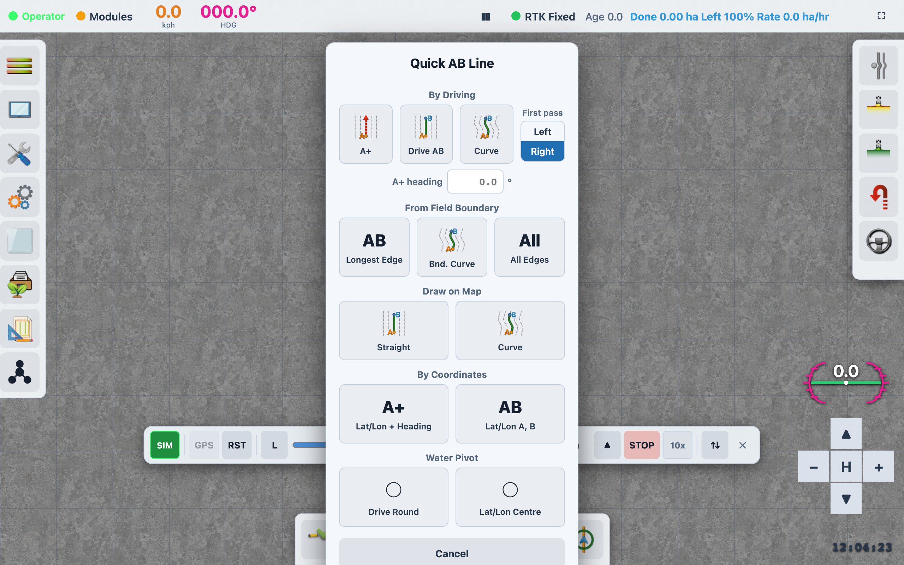
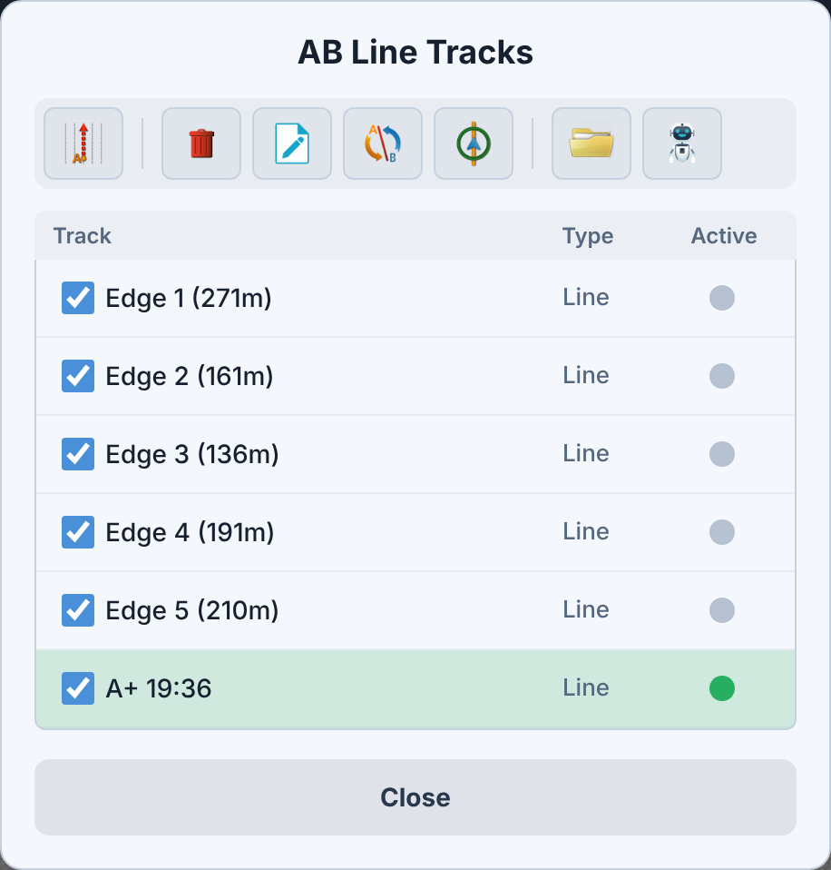
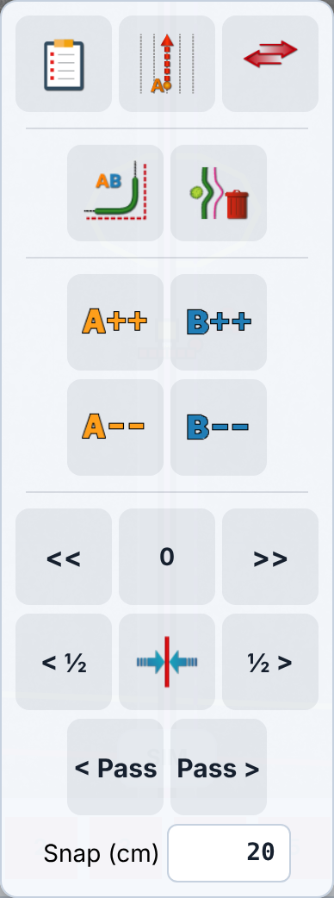

A **guidance line** (a track) is the line the passes are laid out from. The
passes run parallel to it, one working width apart: the tool's width less any
overlap set on [Tool, Offset](/software/setup/tool/#offset). AutoSteer steers
along the pass you are on, and the light bar shows how far off it you are.

A line belongs to the field: open a field first, see
[Fields and boundaries](/software/fields-and-boundaries/).

## Make a line

Tap the last button on the field bar, then **Quick AB**.

### By driving

| Button   | How                                                                                                        |
| -------- | ---------------------------------------------------------------------------------------------------------- |
| A+       | A straight line through the tractor, in the direction it faces. Type an **A+ heading** to use that instead |
| Drive AB | Drive to the start and tap **Set Point**, then drive to the end and tap **Set Point** again                |
| Curve    | Tap **Set Point A**, drive the curve, and tap **Set Point B** at its end                                   |

The tractor drives the middle of a pass, but the line is kept at the edge of
it. **First pass** says which side: AgOpenWeb moves the line half a working
width to the **Right** (to start with) or **Left** of where you drove, so the
first pass runs exactly where you drove.

### From the field boundary

The field needs a [boundary](/software/fields-and-boundaries/#the-boundary).

- **Longest Edge**: a straight line along the longest side of the field.
- **Bnd. Curve**: tap the start and the end on the boundary, choose which way
  round, and tap **Create**. The line follows the boundary between them.
- **All Edges**: a straight line along every side, each named by its length.
  Choose the one you want in **Tracks**.

### Drawn on the map, or typed

- **Straight**: tap two points on the map.
- **Curve**: tap points along the curve, then **Finish**.
- **Lat/Lon + Heading**: a straight line through a point, at a heading in
  degrees true.
- **Lat/Lon A, B**: a straight line through two points. **Use current
  position** fills in where the tractor is.

A line from the boundary, drawn or typed is the edge between two passes, not
the middle of one: the passes lie half a working width each side of it. So with a
line along a boundary edge, the first pass inside the field has the tool's
edge on the boundary.

### Water pivot

For a centre-pivot irrigator, the passes are circles round its centre. **Drive
Round** finds the centre as you drive part of the way round it. **Lat/Lon
Centre** takes the centre's latitude and longitude.

## Choose the line and the pass

**Tracks**, in the same menu, lists the field's lines.

- The **tick** shows or hides a line. A hidden line cannot be used.
- The green dot in **Active** is the line in use. Choose another and tap
  **Activate** (the round button) to use it.
- The other buttons make a **New** line, **Delete**, **Rename**, **Swap A and
  B** (the line's direction), **Import** the lines of another field, and show
  or hide **recorded paths**.

With two or more lines shown and one in use, three more buttons appear on the
right bar: **next track**, **previous track**, and **Auto track**, which picks
the line nearest to the tractor.

While AutoSteer is off, AgOpenWeb shows the pass nearest to where the tractor
is heading, so the line moves to the next pass as you turn onto it. How far
ahead it looks is **Next guidance (s)** on the AutoSteer panel's Display tab.
With AutoSteer on, the pass changes at a U-turn, or when you ask.

## The guidance line menu

From the top:

| Button                    | What it does                                                  |
| ------------------------- | ------------------------------------------------------------- |
| Tracks                    | The list of lines, above                                      |
| Quick AB                  | Make a new line                                               |
| Reference line nudge      | Move the saved line itself, below                             |
| Smooth                    | Smooth a curve: **−** and **+**, then **Save**, or **Cancel** |
| Delete contour paths      | Clear the strips that [Contour](#contour) follows             |
| `A++`, `B++`              | Make the line 5 m longer at the A end or the B end            |
| `A--`, `B--`              | Make it 5 m shorter at that end                               |
| **<<** and **>>**         | Nudge the guidance left or right by the **Snap** distance     |
| The number between them   | How far it is nudged now. Tap it to put it back to 0          |
| **< ½** and **½ >**       | Nudge it by half a working width                              |
| Snap to pivot             | Move the guidance onto the tractor                            |
| **< Pass** and **Pass >** | Go to the next pass on that side                              |
| **Snap (cm)**             | The nudge step, 20 cm to start with                           |

**Reference line nudge** and everything below it show only once a line is in
use.

### Nudge or move the line

A **nudge** moves the guidance you follow, for example when the GPS has drifted
since the line was made. The field bar has the same nudge and snap buttons.

**Reference line nudge** moves the saved line itself, for good. Its panel
stays open while you work: the arrows move the line by the step (5 cm to
start with) or by half a working width, **Save** keeps the move, and **Undo**
puts the line back. You can choose another line with the right bar's track
buttons and move that one too.

## Contour

**Contour**, the top button of the right bar, guides along the edge of the
work already done instead of a line. While any section is painting, AgOpenWeb
records the tractor's path as a strip. With Contour on, it builds a guidance
line one working width beside the nearest strip ahead, and keeps it up to
date as you drive.

A **lock** button appears below Contour. Locked, AgOpenWeb keeps following the
same strip. Switching AutoSteer on locks it, and switching AutoSteer off
unlocks it.

There are no U-turns in Contour: the U-turn button is hidden while it is on.
