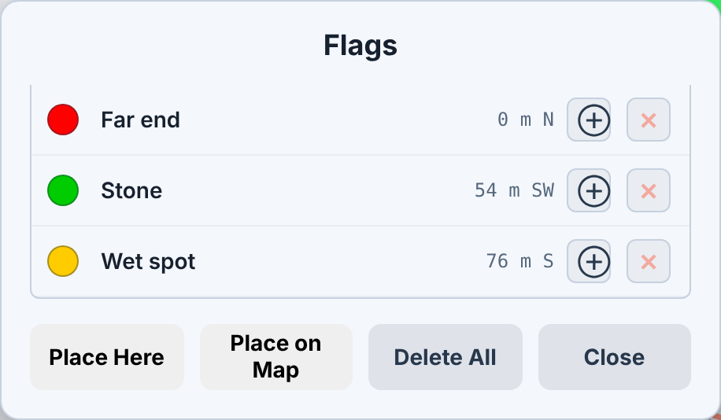
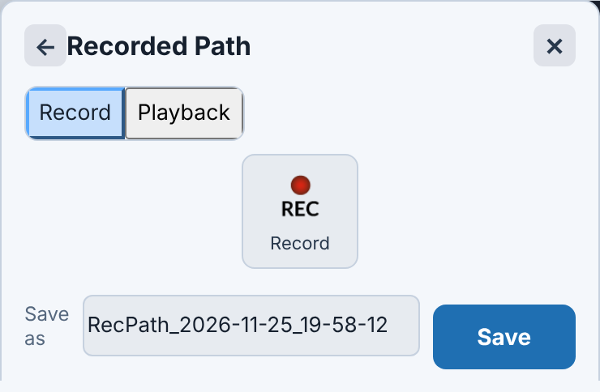
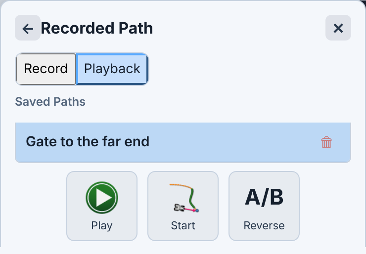
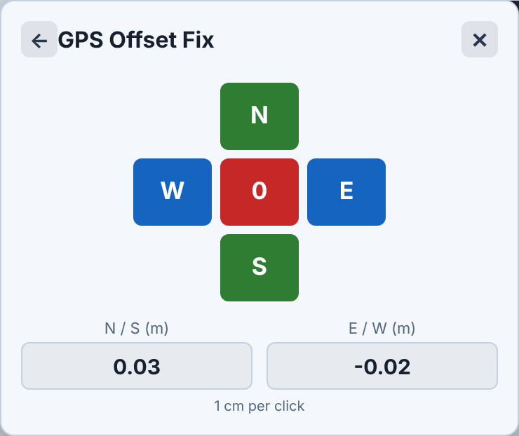

Three more tools for an open field: flags, recorded paths and the GPS offset
fix.

## Flags

A flag marks a spot in the field: a stone, a wet patch, a gateway. It shows on
the map as a dot in its colour, and is saved with the field.

Tap **Flags** on the field bar:

- **Place Flag Here**: at the tractor.
- **Place Flag on Map**: then tap the map where it goes. **✕ Cancel** stops
  without one.
- **Flag List**: all the flags of the field.

Each new flag takes the next colour not used yet: red, green, yellow, blue and
so on. With a keyboard, the **Flag** hotkey (**G** to start with) places one at
the tractor too.

The list shows how far each flag is from the tractor, and in which direction.

- Tap the **colour** to choose another, from ten.
- Tap the **name** to rename it.
- **⊕** moves the map to the flag.
- **✕** deletes it.

**Place Here** and **Place on Map** do the same as in the menu. **Delete All**
removes every flag of the field, after asking.

## Recorded paths

A recorded path is a way you drove, kept so AutoSteer can drive it again: from
the gate to the far end of the field, for example.

Open **Field Tools** on the left bar, then **Recorded Path**.

### Record a path

1. Tap **Record**, and drive.
2. Tap **Stop** at the end. A path shorter than about 10 m is not kept.
3. Type a name under **Save as**, or keep the one given, and tap **Save**.

The path also keeps whether the **Auto sections** button was on as you drove
each part of it.

Each recording you stop also goes into
[Tracks](/software/guidance-lines/#choose-the-line-and-the-pass) as a path.
With **recorded paths** shown there, the field's paths are drawn on the map in
yellow.

### Drive it again

1. Tap the path under **Saved Paths**.
2. The middle button chooses where to join it. Tap it to step through:
   - **Start**: at its beginning.
   - **Last**: where the last playback of it stopped.
   - **Closest**: at the point nearest the tractor.
3. **A/B Reverse** drives the path the other way, from its end.
4. Tap **Play**, then switch AutoSteer on.

AgOpenWeb plans a way from the tractor to the path, turning no tighter than
the tool's U-turn radius, and AutoSteer follows it onto the path and along it.
You drive the speed. The **Auto sections** button is switched on and off as it
was when you recorded. See [Section control](/software/section-control/#the-buttons).

Playback stops at the end of the path, or when you tap **Stop** (the Play
button while it plays). AutoSteer goes off when playback starts and when it
stops.

The bin beside a saved path deletes it, after asking.

## GPS offset fix

When the GPS position has drifted, the guidance lines and the worked area are
no longer where you see them in the field: without RTK, for example. The offset
fix moves every position the GPS gives, so the tractor is back on them.

Open **Field Tools** on the left bar, then **Offset Fix**.

- **N**, **S**, **E** and **W** move the position 1 cm that way for each tap.
- **0** puts it back where the GPS has it.
- **N / S** and **E / W** show the offset in metres: north and east are
  positive, south and west negative. Type a value to set it.

The offset moves everything AgOpenWeb works out from the position: the tractor
on the map, the guidance, the sections and the worked area. It stays when you
open another field. It is not saved: it is back at 0 when AgOpenWeb starts
again.
