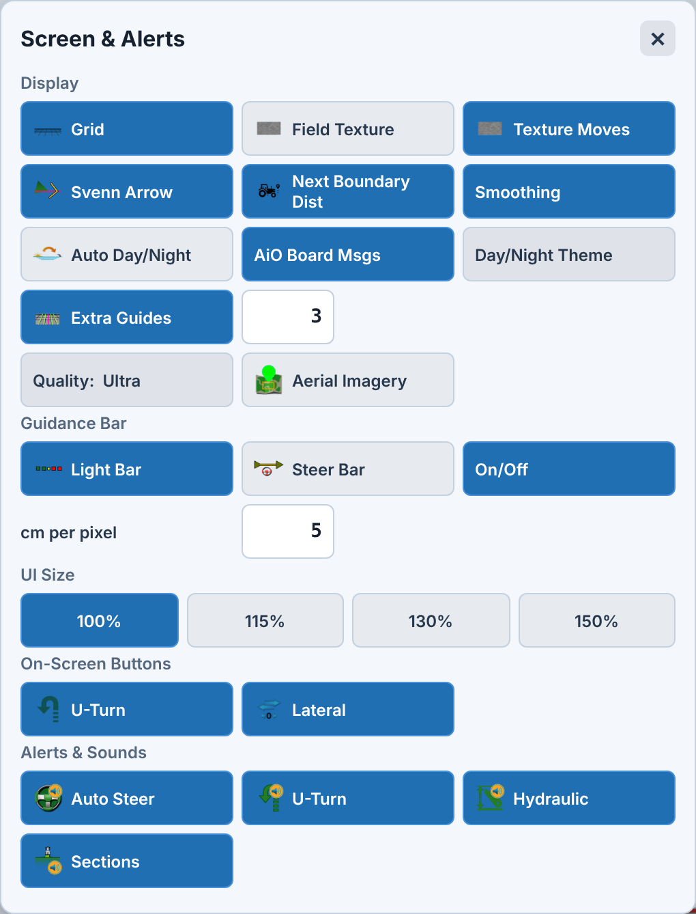
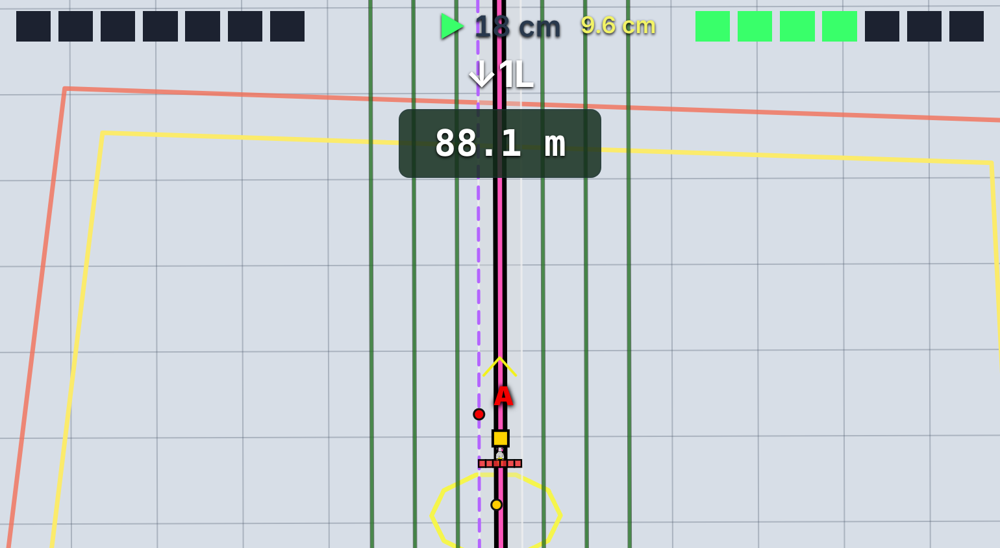
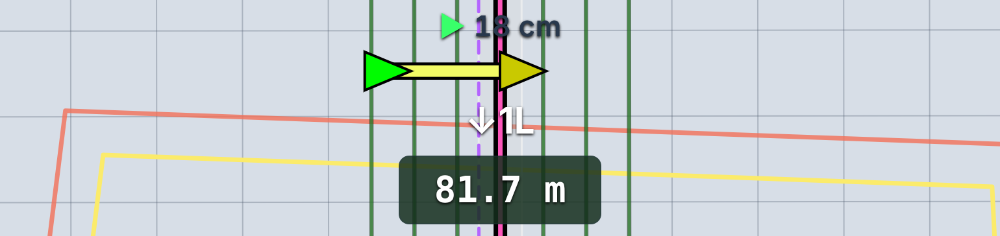

**Screen & Alerts** is the second button on the left bar. A blue button is on:
tap it to switch it. Each change works at once.

The **Guidance Bar** settings are kept with the vehicle profile. All the others
are the same for every vehicle.

## Display

| Button             | What it does                                                                                                                       |
| ------------------ | ---------------------------------------------------------------------------------------------------------------------------------- |
| Grid               | Lines in squares across the ground of the map                                                                                      |
| Field Texture      | A grass picture on the ground. Off, the ground is plain                                                                            |
| Texture Moves      | The texture moves past as you drive, like the ground. Off, it stays still on the screen                                            |
| Svenn Arrow        | A yellow arrow ahead of the tractor that keeps its size at any zoom, so you can always see where it is heading                     |
| Next Boundary Dist | A box under the light bar with the distance ahead to the headland line. It turns red when the line is less than 20 m ahead         |
| Smoothing          | Smooth edges on the lines of the map. Off, they are drawn sharp                                                                    |
| Auto Day/Night     | Day colours from sunrise to sunset where you are, night colours after. Without a GPS position, it goes by the clock: day 6 to 20 h |
| AiO Board Msgs     | Shows on the screen the short messages the AiO board sends                                                                         |
| Day/Night Theme    | Changes to the other colours now. It also switches **Auto Day/Night** off                                                          |
| Extra Guides       | Draws the passes beside the one you are on as thin green lines. The number beside it is how many on each side: 10 to start with    |
| Quality            | How finely the map draws the area worked: **Ultra**, **High**, **Medium**, **Low** or **Min**. Tap to step through them            |
| Aerial Imagery     | The aerial picture of the field under the map                                                                                      |

The **Next Boundary Dist** box shows only while the **Headland** button on the
field bar is on.

**Extra Guides** are not drawn for a water pivot, or when you zoom out so far
that they would run into each other.

A lower **Quality** is less work for a slow tablet. It changes only the
drawing: section control keeps its own fine record of the area worked. When a
phone or tablet connects, the app lowers the quality to **Medium** if it was
higher.

In a field that has no aerial picture yet, **Aerial Imagery** offers to fetch
one for the field's boundary. That needs the internet.

## Guidance Bar

With a guidance line in use, the top of the map shows how far you are from the
line, with a light bar or a steer bar.

- **Light Bar**: seven squares each side of the distance. They light up on the
  side to steer to: green to the right, orange to the left. Each square stands
  for **cm per pixel** (5 cm to start with), so at 5 all seven are lit when you
  are 35 cm or more off the line. The yellow figure beside the distance is how
  far off you have been on average over the last few seconds. It shows while it
  is under 15 cm.
- **Steer Bar**: in place of the squares, a yellow bar for how far the front
  wheels are from the angle the guidance asks for, up to 12°. The arrows point
  the way to turn the steering wheel. Under AutoSteer, it is smaller and paler.
- **On/Off**: shows or hides the bar, and the distance with it.

## UI Size

Makes the buttons, the panels and the figures on the map bigger: **100%**,
**115%**, **130%** or **150%**. A bigger size is easier to hit in a cab that
shakes.

## On-Screen Buttons

At the upper left of the map are two pairs of arrows: **U-Turn** (yellow) and
**Lateral** (blue). Switch a pair off here to hide it. They show only with a
field open and AutoSteer on, and not in Contour mode. What they do is in
[the screen tour](/software/screen-tour/#across-the-top-of-the-map).

## Alerts & Sounds

Each button switches a group of sounds on or off:

| Button     | Sounds when                                                                                                                |
| ---------- | -------------------------------------------------------------------------------------------------------------------------- |
| Auto Steer | AutoSteer goes on or off                                                                                                   |
| U-Turn     | The tractor comes within about 20 m of where a U-turn starts, and when a U-turn cannot be made                             |
| Hydraulic  | The hydraulic lift goes up or down                                                                                         |
| Sections   | **Manual sections** or **Auto sections** goes on or off, and when the sections go off because the GPS or a module was lost |

Some sounds play whatever these say: RTK lost and RTK back, and in Contour mode
the alarm when the line ahead cannot be driven.

Sounds play on the screen you are using, such as the tablet, not on the
computer that runs AgOpenWeb. A browser plays sound only after you have tapped
the page once.
