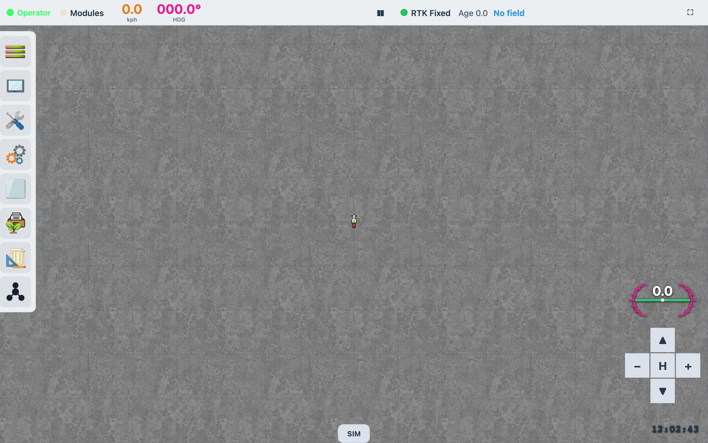
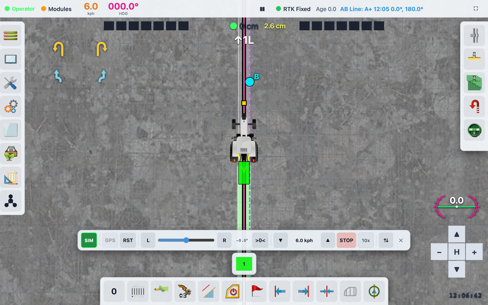
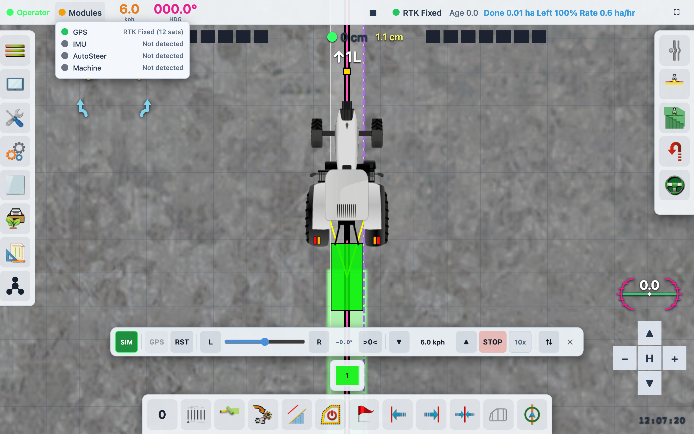
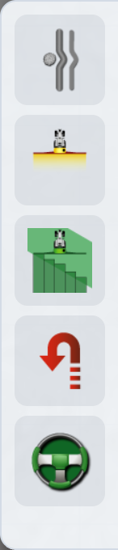
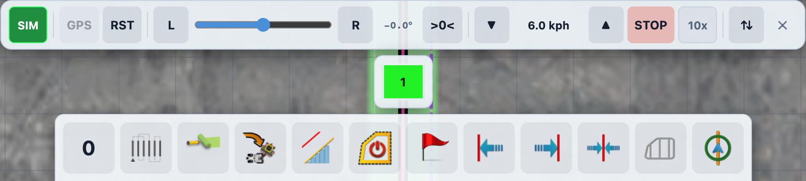
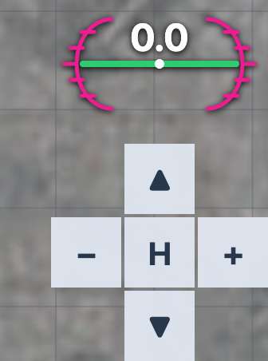

This page names the parts of the screen so the other pages can refer to them.
You do not need to learn it by heart: open the
[simulator](/software/simulator/) and tap along.

## The whole screen

When AgOpenWeb starts with no field open, there is little on the screen: the
status bar across the top, a bar of setup buttons down the left, and the view
controls at the lower right.

Open a field and choose a guidance line, and the working controls appear: the
guidance switches down the right, the field bar along the bottom, and the
guidance readouts across the top of the map.

| Where       | What it is for                                                                        |
| ----------- | ------------------------------------------------------------------------------------- |
| Top         | **Status bar**: who is in control, the modules, speed, heading, GPS quality           |
| Left        | **Setup bar**: settings, profiles, fields. Nothing here steers the machine            |
| Right       | **Guidance switches**: sections, U-turn, AutoSteer. Only with a field open            |
| Bottom      | **Field bar**: headland, flags, tram lines, the guidance line. Only with a field open |
| Lower right | **View controls**: tilt, zoom, view mode, and the roll gauge                          |

## Status bar

From left to right:

1. **Control role.** **Operator** means this screen is in control. **Observer**
   means another screen is, and this one only watches. See
   [Using a second screen](/software/install/second-screen/).
2. **Modules.** One dot for all your modules. Tap it for the state of each:
   GPS, IMU, AutoSteer and Machine.
3. **Speed**, in km/h or mph.
4. **Heading**, in degrees.
5. **Pause** (❚❚). The blue line of text to its right changes every few
   seconds between the field name, the work done, and the guidance line. Pause
   holds it on the one showing.
6. **GPS quality**, such as _RTK Fixed_, with the age of the corrections in
   seconds. Tap it for the GPS details.
7. **Fullscreen**, at the far right. Hides the browser's own bars.

## Setup bar (left)

Each button opens a panel. From the top:

1. **File menu.** Language, App Settings (units, on-screen keyboard), Hotkeys,
   the Simulator, the Log Viewer, Help, About and **Bug Report Dump**. See
   [Language, app settings and hotkeys](/software/app-settings/) and
   [Charts, logs and bug reports](/software/charts-logs-bug-reports/).
2. **Screen & Alerts.** What is drawn on the map (grid, field texture, extra
   guide lines, aerial imagery), the day or night theme, the light bar, the
   size of the buttons, and which sounds play. See
   [Screen & Alerts](/software/screen-and-alerts/).
3. **Tools.** The Steer Wizard, Roll Correction, and live charts of steering,
   heading and distance from the line. See
   [Charts](/software/charts-logs-bug-reports/#charts).
4. **Vehicle & Tool.** Choose, create and configure your vehicle and tool
   profiles. See [Profiles](/software/setup/profiles/).
5. **AutoSteer.** The steering settings. See
   [AutoSteer settings](/software/setup/autosteer/).
6. **Field Operations.** Open or create a field, start or resume a job, close
   the field. See [Fields and boundaries](/software/fields-and-boundaries/).
7. **Field Tools.** The Field Builder, boundaries, recorded paths, importing
   tracks from another field, deleting the applied area, and the GPS offset
   fix. See [Fields and boundaries](/software/fields-and-boundaries/) and
   [More field tools](/software/more-field-tools/).
8. **Network IO.** Your modules on the network, and the RTK corrections
   (NTRIP). See [Network IO](/software/connect/network-io/).

## Guidance switches (right)

These appear when a field is open. Each one shows by its picture whether it is
on. From the top:

1. **Contour.** Guide along the edge of what you have already worked.
2. **Manual sections.** Switch all sections on by hand.
3. **Auto sections.** Let AgOpenWeb switch the sections by what is already
   worked and by the boundary.
4. **U-Turn.** Make the turns at the end of each pass automatically. See
   [U-turns](/software/u-turns/).
5. **AutoSteer.** Steer along the guidance line.

On an observer's screen these are locked.

## Across the top of the map

With a guidance line active, three things appear under the status bar:

- **The light bar**: rows of squares that light up to show how far off the
  line you are, and to which side.
- **Distance from the line**, in centimetres, with a dot that is green when you
  are on it.
- **The pass you are on**, such as `↑1L`: its number, and whether it lies to
  the left or right of the line you made.

At the upper left of the map are four arrows. The yellow pair starts a
**U-turn** to the left or right now. The blue pair **moves the guidance to the
next pass** on that side. They show only while AutoSteer is on, and not with
Contour on. Screen & Alerts can hide either pair.

## Simulator, sections and the field bar (bottom)

Three bars stack at the bottom of the map.

**The simulator bar** drives a pretend tractor. It is explained on the
[simulator page](/software/simulator/). Its ✕ shrinks it to a small **SIM**
button.

**The section buttons** show one button for each section of your tool. Tap one
to step it through **Off**, **Auto** and **On**. See
[Section control](/software/section-control/).

**The field bar**, from left to right:

1. **U-turn skip rows**: how many passes a U-turn skips. Tap to step from 0
   to 9.
2. **U-turn skip mode**: normal, alternate, or skip the passes already worked.
3. **Section mapping colour**: the colour the worked area is painted in.
4. **Reset tool heading.**
5. **Section control in headland**: whether sections may come on in the
   headland.
6. **Headland on/off.**
7. **Flags**: mark a spot, at the tractor or on the map. See
   [More field tools](/software/more-field-tools/#flags).
8. **Nudge left** and
9. **Nudge right**: move the line sideways by the snap distance.
10. **Snap to pivot**: move the line to where the tractor is.
11. **Tram lines**: step through the ways of showing them. See
    [Tram lines](/software/tram-lines/).
12. **Guidance line menu**: make, choose and adjust lines.

Buttons 1, 2, 8, 9 and 10 need a guidance line, and are not shown until you
have one.

### The guidance line menu

The last button on the field bar opens everything to do with lines:

- **Tracks**: the list of saved lines. Choose, rename, delete.
- **Quick AB**: make a new line by driving, from the boundary, by drawing on
  the map, or from coordinates.
- **Nudge**: move the line by the snap distance or by half a tool width, move
  to the next pass, or reset the nudge to 0.
- **Extend** and **shorten** the line at A or at B.
- **Smooth** a curve, and **delete contour paths**.

See [Guidance lines](/software/guidance-lines/).

## View controls (lower right)

These change what you see and nothing else.

- **▲** and **▼** tilt the view between straight down and a 3D view from behind
  the tractor.
- **−** and **+** zoom.
- The middle button steps through the view modes, and shows the letter of the
  one in use: **H** heading up (the tractor always points up the screen), **N**
  north up, **M** map (the map holds still until the tractor nears the edge),
  **C** free (stays where you drag it).
- The **roll gauge** above shows how far the tractor leans.

You can also drag the map with a finger and pinch to zoom.
