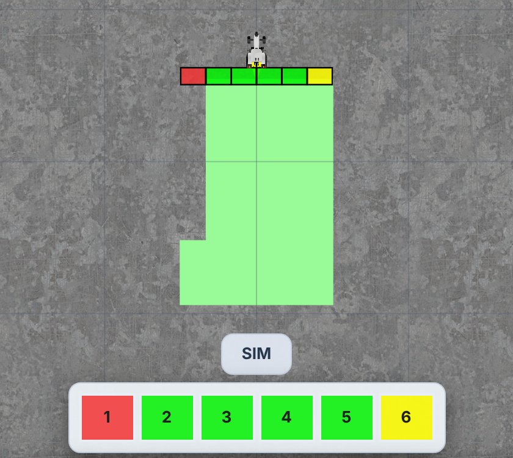

A tool is split into **sections**: parts of a boom, groups of nozzles, row
units. AgOpenWeb can switch each one on and off by itself as you drive: on
over ground still to be worked, off over ground already worked, outside the
field and in the headland. What has been worked is painted on the map.

The sections reach the valves through the
[machine module](/software/setup/machine-module/). Without one, AgOpenWeb
still paints the map, which is a good way to try section control before the
tool is wired.

## Before you start

- **The sections.** Set their number and widths in the tool profile: see
  [Tool, Sections](/software/setup/tool/#sections).
- **The timing.** Tell AgOpenWeb how long your valves take to open and close:
  see [Tool, Timing](/software/setup/tool/#timing).
- **A relay for each section.** On the machine module's
  [Pin Config](/software/setup/machine-module/#pin-config), every section
  needs a pin. The starting layout has sections 1 to 6 only.
- **A field open.** With no field open, no section comes on by itself. The
  field does not need a boundary: without one, only the worked area decides.

## The buttons

Two buttons on the right bar set every section at once:

| Button          | First tap                 | Second tap        |
| --------------- | ------------------------- | ----------------- |
| Auto sections   | Every section to **Auto** | Every section off |
| Manual sections | Every section **On**      | Every section off |

Below the map there is one button for each section (or each zone, with
[zones](/software/setup/tool/#zones)). Tap one to step it through **Off**,
**Auto** and **On**. Use it to keep one section shut, or open, whatever
AgOpenWeb would do.

The buttons and the tool on the map show each section's state by colour:

| Colour | The section is                |
| ------ | ----------------------------- |
| Red    | Off                           |
| Grey   | In Auto, and off              |
| Orange | In Auto, and about to come on |
| Green  | In Auto, and on               |
| Cyan   | In Auto, and about to go off  |
| Yellow | On by hand                    |

## When an Auto section is on

An Auto section comes on when the ground just ahead of it is:

- **not yet worked**: less of it painted than **Min coverage**. A new tool
  has 100 %, so any ground not fully worked is enough;
- **inside the field**, and clear of obstacles;
- **not in the headland**;

and the tractor is going forwards faster than **Slow speed cutoff**.

It goes off when the ground ahead is all worked, when it would leave the field
or cross an obstacle, when it is in the headland, when you slow down below
the cutoff, and when you back up.

A section stays on while any real part of the ground ahead is unworked. A
pass over a strip that was only partly worked fills the gaps instead of
switching off.

A section set **On** by hand stays on through all of this: outside the field,
in the headland, stopped and backing up.

[Switches](/software/setup/tool/#switches) wired to your modules, such as a
work switch on the tool, can also work the sections.

## The field's edge and obstacles

With **Off outside boundary** on (Tool, Sections, the default), a section is
outside as soon as it is not fully inside the field. A small leeway at the
edge keeps the outer section open on a lap with the end of the boom on the
boundary, through the small movements of the GPS.

Sections are always off over an obstacle (an inner boundary), whether it is
marked **Drive Thru** or not. Drive Thru only lets a U-turn cross it.

## The headland

Sections go off in the headland when both of these are on:

- **Headland on/off** on the field bar, and
- **Section control in headland** on the field bar. It is the same setting as
  **Off in headland** on Tool, Sections.

A section counts as in the headland only when **both its ends** are in it.
Where a pass meets the headland line at an angle, the section stays on until
its last end crosses the line, so nothing inside the line is missed. The rest
of the section lands in the headland, which the headland laps work anyway.

## Timing and the painted map

The machine module is told **Look ahead on** seconds before the section
reaches unworked ground, and **Look ahead off** seconds before it reaches
worked ground, so the valve is already open or shut at the edge. The map
waits the same time before it paints, so the paint starts and stops where the
product lands.

If the timing is right, the edges of the painted area match the edges of the
product on the ground. If the product starts late at the edges, raise **Look
ahead on**. If it runs on past them, raise **Look ahead off**.

## The worked area

The worked area is painted in the tool's **Coverage colour**, or in a colour
for each section with **Multi-coloured sections** on. **Section mapping
colour** on the field bar changes it. **Coverage margin** paints a little
extra at each edge so that no thin unworked strips show between passes.

The worked area is saved with the job you are working in, so start or resume a
job in **Field Operations** before you work. If you have worked with only the
field open, closing the field asks whether to **Save to Job** or **Discard**
the worked area.

**Field Tools**, **Delete Applied Area** clears it.

If the machine module stops answering, the sections keep their state but
nothing more is painted: a module switches its outputs off by itself when it
stops hearing AgOpenWeb, so that ground was not worked. An Auto section works
it on a later pass.

## When a section shows but no valve opens

AgOpenWeb checks this when you switch sections on with a machine module
connected. If a section has no pin, a message says so, for example:

> No relay of the machine module has section(s) 7 to 12: they show on the
> map, but no valve opens. Set them in Tool › Machine › Pin Config.

Give those sections a pin on
[Pin Config](/software/setup/machine-module/#pin-config) and tap **Save
Profile**.
