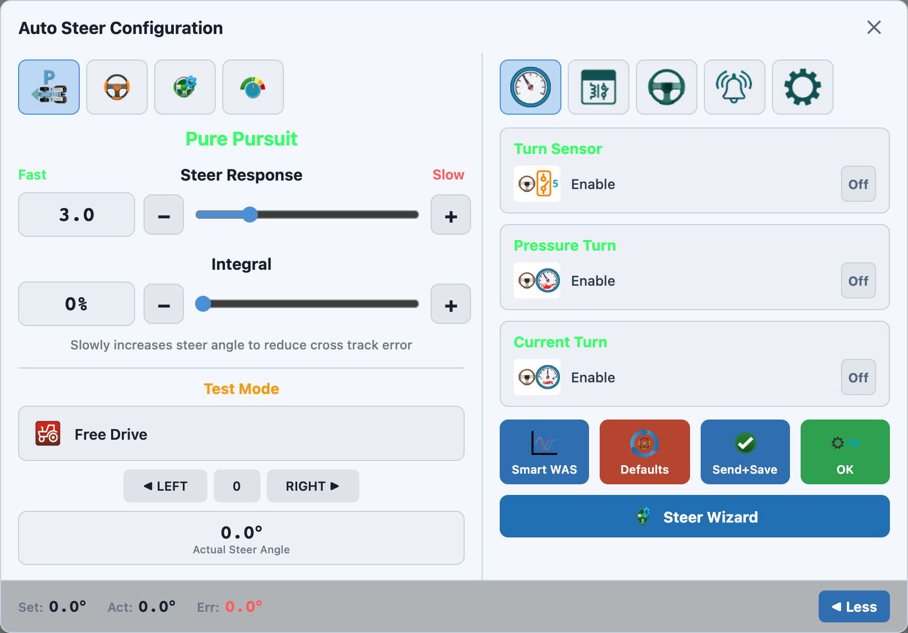

**AutoSteer**, the fifth button on the left bar, opens the steering settings.
Run the [Steer Wizard](/software/setup/steer-wizard/) first: it fills in most
of this page for you. Come here to tune how the tractor follows the line.

The panel opens small, with the four tabs you use while driving. **▶ Full** at
the lower right opens the rest: five more tabs, **Test Mode** and the buttons.

## Reading the bottom line

| Reading | Meaning                                 |
| ------- | --------------------------------------- |
| Set     | The wheel angle AgOpenWeb is asking for |
| Act     | The wheel angle the sensor reports      |
| Err     | The difference                          |

While AutoSteer is working, **Act** should follow **Set** closely. If it
lags, the steering is too gentle. If it jumps past and comes back, it is too
strong.

## Saving

A slider works at once in AgOpenWeb. **Send+Save** sends the settings to the
steer module and saves them in the vehicle profile. **OK** does the same and
closes the panel.

**Defaults** puts every AutoSteer setting back to its starting value, after
asking.

## Where to start when tuning

Change one thing at a time, at working speed, on a straight line.

1. **The wheels must follow first.** Watch **Set** and **Act**. Raise
   **Proportional Gain** until the wheels follow quickly, and lower it if they
   shake. If small corrections do nothing, raise **Minimum To Move**.
2. **Then the line.** With Pure Pursuit, move **Steer Response** towards
   **Fast** if the tractor is lazy coming back to the line, towards **Slow**
   if it weaves.
3. **A steady offset to one side** is not a tuning problem. Run
   [Smart WAS](/software/setup/smart-was/), and check the antenna offset.

## The four driving tabs

### Pure Pursuit or Stanley

The first tab shows the settings of the steering method in use. You choose the
method on the **Algorithm** tab.

- **Steer Response** (Pure Pursuit): how far ahead the tractor aims. **Fast**
  is sharper, **Slow** is smoother.
- **Aggressiveness** and **Overshoot Reduction** (Stanley): how hard it turns
  towards the line, and how much it eases off as it arrives.
- **Integral**: slowly adds steering when the tractor stays a little off the
  line. Start at 0 and add only a little.

### Steering sensor

| Setting           | What it does                                                                                |
| ----------------- | ------------------------------------------------------------------------------------------- |
| WAS Offset        | The sensor reading that means straight ahead. **Zero WAS** sets it with the wheels straight |
| Counts Per Degree | How much the reading changes for one degree. The wizard's circle test finds it              |
| Ackermann         | Corrects for left and right turns measuring differently. 100 is neutral                     |
| Max Steer Angle   | The largest wheel angle AutoSteer asks for                                                  |

### Deadzone and timing

| Setting                 | What it does                                                        |
| ----------------------- | ------------------------------------------------------------------- |
| Deadzone Heading        | A heading error smaller than this is left alone, so the wheel rests |
| On Delay                | How long the error must last before steering starts again           |
| Look-ahead Speed Factor | How much further ahead the tractor aims as it goes faster           |
| Acquire Factor          | How it aims while still coming onto the line                        |

### Gain and PWM

| Setting                   | What it does                                                  |
| ------------------------- | ------------------------------------------------------------- |
| Proportional Gain         | How hard the motor or valve is driven for a given wheel error |
| Max Limit (high PWM)      | The most power it may use                                     |
| Minimum To Move (low PWM) | The least power that moves the wheels                         |

## Test Mode

**Free Drive** lets you steer the wheels from the screen, to check the motor
and the sensor without a guidance line.

1. Stop the tractor and keep clear of the steering wheel.
2. Tap **Free Drive**.
3. Tap **◀ LEFT** and **RIGHT ▶** to ask for a few degrees more each way,
   and **0** for straight ahead.

**Actual Steer Angle** should follow what you ask for. Tap **Free Drive**
again to stop.

:::caution
Free Drive moves the real steering, also while the simulator is on.
:::

## The five setup tabs

### Turn sensors

How AutoSteer notices that you have taken the wheel, so it can let go. Switch
on the one your tractor has and set the level at which it trips.

- **Turn Sensor**: an encoder on the steering wheel.
- **Pressure Turn**: a pressure sensor in the hydraulic steering.
- **Current Turn**: the current drawn by the steering motor.

### Hardware

**Danfoss valve**, **Invert WAS**, **Invert motor**, **Invert relays**,
**Motor driver**, **A/D converter**, **IMU axis**, and **Steer switch /
button**: whether a switch or button wired to the steer module engages
AutoSteer. The wizard sets all of these.

### Algorithm

- **Algorithm**: **Pure Pursuit** or **Stanley**. Pure Pursuit is the usual
  choice.
- **U-Turn Compensation**: moves the tractor's path through a U-turn out (−)
  or in (+).
- **Side-hill Compensation**: extra steering uphill for each degree of roll.
- **Steer in reverse**: allow AutoSteer while backing up.

### Speed limits

- **Min steer speed** and **Max steer speed**: AutoSteer works only between
  these.
- **Manual turns** and **Manual turns speed**: with **Manual turns** on, the
  U-turn and next-pass arrows on the map, and **< Pass** and **Pass >** in the
  guidance line menu, do nothing above this speed (12 km/h to start with). A
  message says so, such as _Too fast: slow down below 12 kph_.

### Display

- **Line Width**: how thick guidance lines are drawn.
- **Nudge distance**: how far one tap of the nudge buttons moves the line.
- **Next guidance (s)**: with AutoSteer off, the line shown is the pass
  nearest to where the tractor will be in this many seconds (1.5 to start
  with). When you turn onto the next pass by hand, the line moves to it before
  you get there.

## Charts

**Tools** on the left bar has a **Steer Chart**, a **Heading Chart** and an
**XTE Chart** (distance from the line). They float over the map while you
drive, which makes tuning much easier to judge. See
[Charts](/software/charts-logs-bug-reports/#charts).
