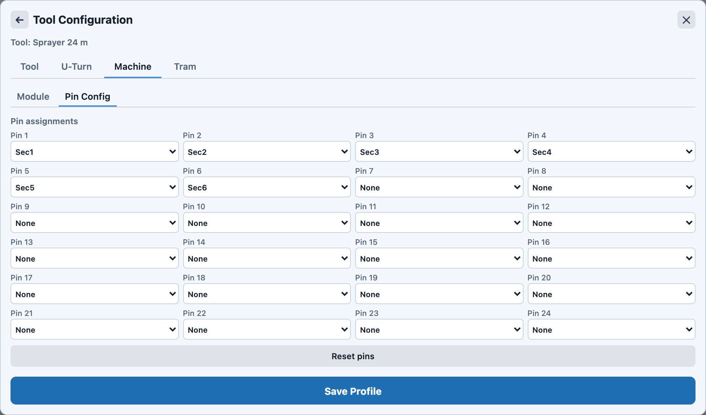

The machine module switches things on the tool: section valves, the hydraulic
lift, tram line markers. You only need this page if you have one.

Its settings belong to the tool profile. Open **Vehicle & Tool**, **Configure
Tool…**, then the **Machine** tab. It has two tabs of its own: **Module** and
**Pin Config**.

First check on [Network IO](/software/connect/network-io/) that **Machine** is
ticked and its dot is green.

## Module

### Hydraulic lift

With **Enable** on, AgOpenWeb raises the tool as you come into the headland
and lowers it as you leave.

| Setting      | What it does                                                       |
| ------------ | ------------------------------------------------------------------ |
| Raise time   | How long the raise output stays on                                 |
| Lower time   | How long the lower output stays on                                 |
| Look ahead   | How early to start, so the tool is up or down at the headland line |
| Invert relay | For relay boards that switch on when the signal is off             |

### User values

**User 1** to **User 4** are four numbers passed to the machine module as they
are. They do nothing unless your module's firmware uses them.

## Pin Config

There are 24 pins to assign. For each one, choose what it does:

| Choice              | The output is on when                |
| ------------------- | ------------------------------------ |
| None                | Never                                |
| Sec1 to Sec16       | That section is on                   |
| HydUp, HydDown      | The lift is being raised or lowered  |
| TramRight, TramLeft | The tram line on that side is active |
| GeoStop             | The tractor is out of the field      |

**GeoStop** counts the tractor as out of the field when the middle of its rear
axle is outside the field boundary or inside an obstacle (an inner boundary).
The boundary is drawn red at the same time. During an automatic U-turn it keeps
the state it had when the turn began. A field with no boundary never sets it.

**Reset pins** puts them back to the starting layout: pins 1 to 6 are sections
1 to 6, and the rest are unused.

Tap **Save Profile** to keep the layout.

:::tip
You can test the outputs on the bench with the
[simulator](/software/simulator/). Sections and the lift are still sent to the
machine module while it runs.
:::
