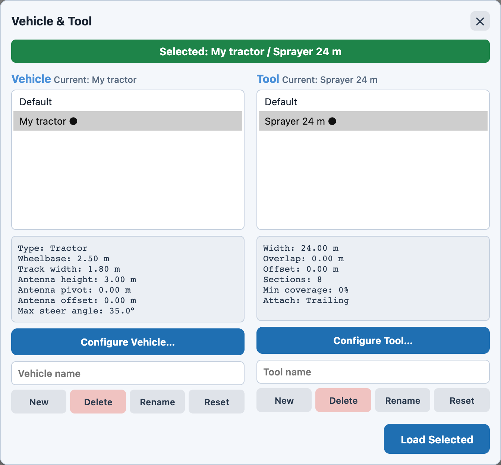

A **profile** is a set of settings saved under a name. AgOpenWeb keeps two
kinds, and you choose one of each:

- a **vehicle profile**: the tractor's measurements, its antenna, GPS and roll
  settings, and its steering settings,
- a **tool profile**: the tool's kind, width and sections, the machine
  module's settings, and the U-turn and tram line settings.

So one tractor can work with a drill in the morning and a sprayer in the
afternoon by changing only the tool.

**Vehicle & Tool**, the fourth button on the left bar, is where you manage
them.

Vehicles are on the left, tools on the right. The green bar shows the pair
selected in the lists. The profile in use is marked **●** and named after
_Current:_. Under each list is a summary of the selected profile.

## Make a profile

1. Type a name in **Vehicle name** or **Tool name**.
2. Tap **New**.

The new profile starts as a copy of the settings in use now, and becomes the
one in use. Then tap **Configure Vehicle…** or **Configure Tool…** to change
it: see [Vehicle](/software/setup/vehicle/) and [Tool](/software/setup/tool/).

A new install has one profile of each kind, called **Default**.

## Switch to another profile

Select a vehicle and a tool in the lists and tap **Load Selected**. AgOpenWeb
saves the pair you were using, then loads the new one.

**Configure Vehicle…** and **Configure Tool…** also load the selected profile
before they open it.

## Save your changes

A setting you change in **Vehicle Configuration** or **Tool Configuration**
works at once. Tap **Save Profile** at the bottom of the panel to keep it in
the profile.

## Rename, delete, reset

- **Rename.** Select the profile, type the new name, tap **Rename**.
- **Delete.** Select the profile and tap **Delete**. AgOpenWeb asks first.
- **Reset** puts the **Default** profile of that kind back to the settings of
  a new install. Your named profiles are not touched.

## Where they are kept

Profiles are files in the AgOpenWeb data folder, in `VehicleProfiles` and
`ToolProfiles`. They are included when you copy the data folder to another
device.
