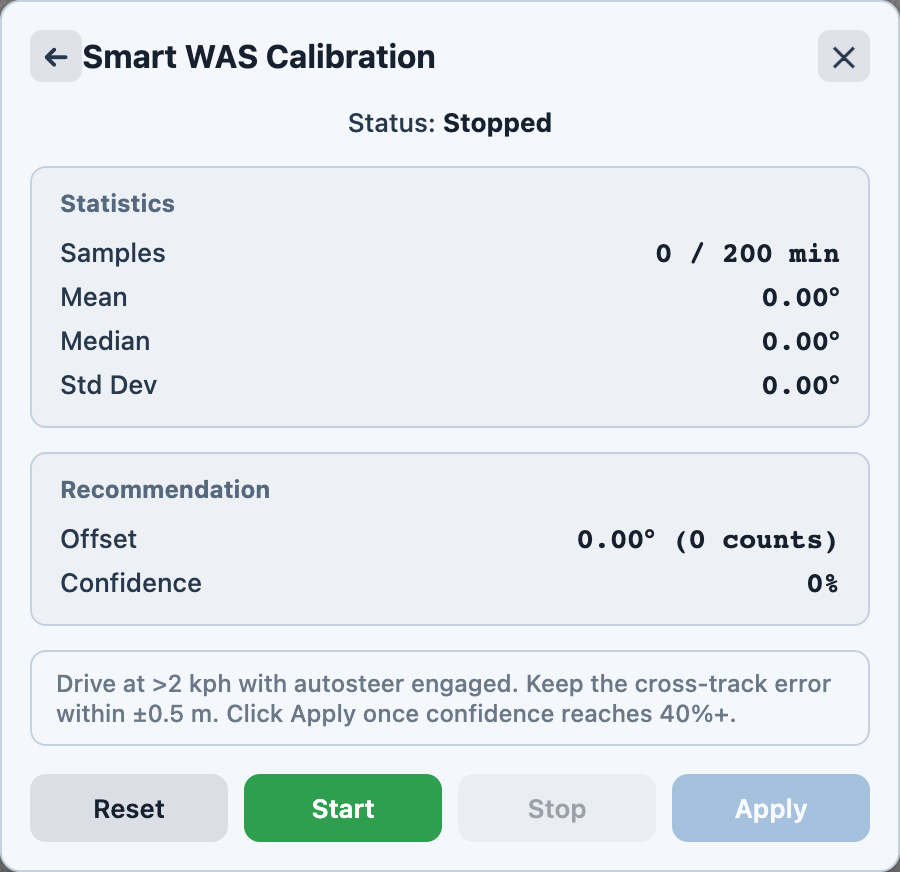

Zeroing the wheel angle sensor by eye is never quite exact. If the zero is a
little off, the tractor follows the line a steady few centimetres to one side.

**Smart WAS** finds the true centre by watching the steering while AutoSteer
drives straight lines, and works out the correction for you.

Open **AutoSteer** on the left bar, tap **▶ Full**, then **Smart WAS**.

## How to use it

1. Open a field and make a straight guidance line.
2. Engage AutoSteer and drive along it at more than 2 km/h.
3. Tap **Start**. The status changes to _Collecting_.
4. Keep driving straight passes. Stay within half a metre of the line.
5. Watch **Samples** and **Confidence** rise. It needs at least 200 samples.
6. When **Confidence** is 40% or more, tap **Apply**.

**Offset** shows the correction it will make, in degrees and in sensor counts.

Drive on flat ground if you can, in both directions, and leave out the turns.

## The buttons

| Button    | What it does                                     |
| --------- | ------------------------------------------------ |
| **Start** | Begin collecting                                 |
| **Stop**  | Pause collecting                                 |
| **Reset** | Throw away what has been collected               |
| **Apply** | Move the sensor's zero by the recommended offset |

## Reading the numbers

- **Mean** and **Median** are the average wheel angle while driving straight.
  On a perfectly zeroed sensor both are 0.
- **Std Dev** shows how much the angle moved about. A large value means the
  driving was not steady enough: wait for more samples.

After **Apply**, tap **Reset** and collect again if you want to check. The
offset it recommends should now be close to 0.
