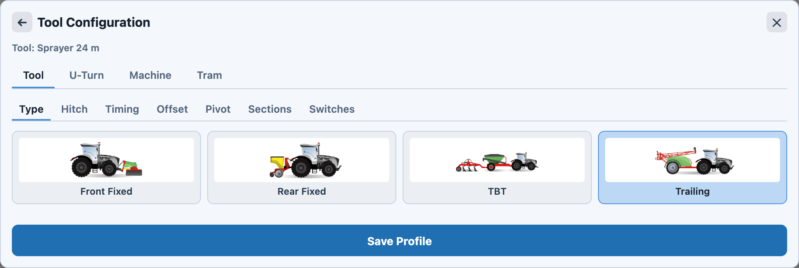
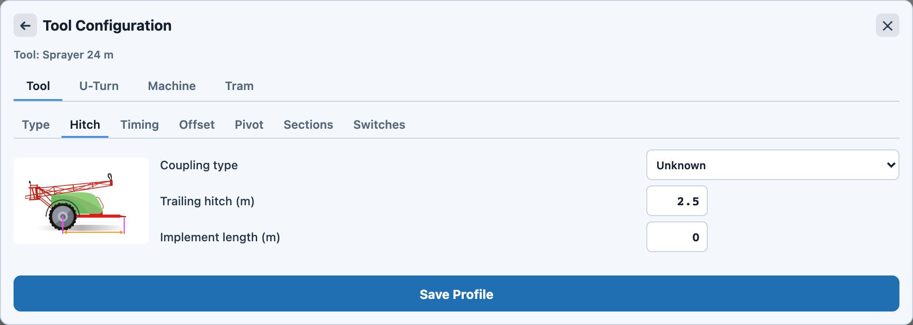
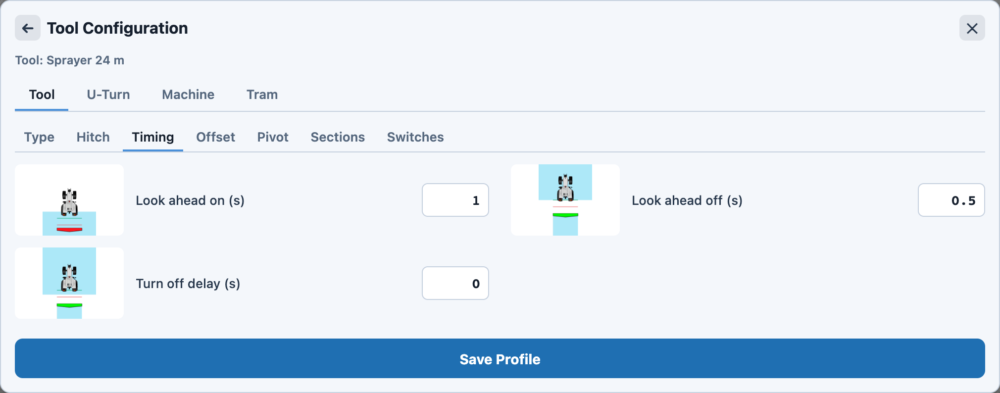
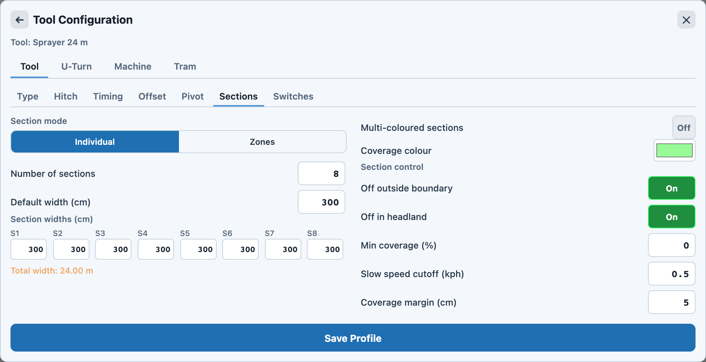

Open **Vehicle & Tool** on the left bar, select the tool, and tap **Configure
Tool…**.

The panel has four tabs across the top: **Tool**, **U-Turn**, **Machine** and
**Tram**. This page covers **Tool**, which has a second row of tabs of its
own. A change works at once. Tap **Save Profile** to keep it.

## Type

| Type        | Use it for                                                                 |
| ----------- | -------------------------------------------------------------------------- |
| Front Fixed | A tool on the front linkage, or a harvester's header                       |
| Rear Fixed  | A tool carried on the rear 3-point linkage                                 |
| Trailing    | A tool pulled on the drawbar that runs on its own wheels                   |
| TBT         | "Tow between tank": a tank or cart on the drawbar, with the tool behind it |

The type decides which measurements the other tabs ask for.

## Hitch

The picture shows the measurement for the type you chose.

**For a fixed tool (front or rear):**

- **Hitch to working point**: from the tractor's lower-link pins to the line
  where the tool works the ground (the coulters, the nozzles).

  The grey line under it adds the tractor's own hitch length from the
  [vehicle profile](/software/setup/vehicle/#hitch) and shows the total from
  the rear axle.

**For a trailing tool:**

- **Trailing hitch**: from the drawbar pin back to the tool's wheels.

**For a TBT tool**, there are two:

- **Tank trailing hitch**: from the tractor's drawbar pin back to the wheels
  of the tank or cart.
- **Trailing hitch**: from the hitch on the tank or cart back to the tool's
  wheels.

**For every type:**

- **Implement length**: the length of the tool from front to back. It is used
  to keep the tool clear of a boundary you have marked as hard during a
  U-turn. It does not change how the tool is drawn.

**Coupling type** records the kind of hitch with the profile. It does not
change the guidance.

## Timing

A valve takes time to open and close. These settings tell AgOpenWeb to ask
early, so that the product starts and stops at the edge.

| Setting        | What it does                                                                              |
| -------------- | ----------------------------------------------------------------------------------------- |
| Look ahead on  | How many seconds before the edge a section is switched on                                 |
| Look ahead off | How many seconds before the edge a section is switched off                                |
| Turn off delay | Keep a section on for this long after it should go off. Used when **Look ahead off** is 0 |

A new tool starts with 1.0 second on and 0.5 seconds off, which suits most
sprayers.

## Offset

- **Tool offset**: how far the centre of the tool is to the **Left** or
  **Right** of the centre of the tractor. Choose **Zero** for a tool that is
  centred.
- **Overlap / gap**: make each pass **Overlap** the one before by this much,
  or leave a **Gap**. **Zero** places the passes exactly one tool width apart.

## Pivot

For **Trailing** and **TBT** tools only. If the working line of the tool is
not at its wheels, enter the **Pivot distance** between them and say whether
the tool is **ahead of its wheels** or **behind its wheels**. The picture
shows the one you chose.

## Sections

The width of the tool is the sum of its sections. There is no separate width
to enter: the **Total width** line shows the result.

1. Choose **Individual** if every section has a valve or clutch of its own.
2. Enter the **Number of sections**, from 1 to 64.
3. Enter the **Default width**. Every section is set to it.
4. If your sections differ, type each one's width under **Section widths**.
   **S1** is the leftmost section.

A tool with no section control is one section as wide as the tool.

### Zones

Choose **Zones** when many small sections are switched together in a few
groups. Enter the **Number of zones** (up to 8), and for each zone the number
of the last section in it.

### Colours

The worked area is painted in the **Coverage colour**. Switch
**Multi-coloured sections** on to give each section a colour of its own.

### Section control

| Setting              | What it does                                                                                                         |
| -------------------- | -------------------------------------------------------------------------------------------------------------------- |
| Off outside boundary | Switch a section off when it is outside the field boundary                                                           |
| Off in headland      | Switch a section off when it is in the headland                                                                      |
| Min coverage         | An Auto section comes on only when less than this much of the ground ahead is worked. A new tool has 100 %           |
| Slow speed cutoff    | Below this speed all sections are off                                                                                |
| Coverage margin      | Extra width painted at each edge of the worked area, so that small GPS movements do not leave slivers between passes |

How the sections behave in the field: see
[Section control](/software/section-control/).

## Switches

Switches wired to your modules can work the sections.

- **Work switch**: a switch on the tool, such as one that closes when it is
  lowered. Say whether it is **Active low (closed)** or **Active high
  (open)**, and whether it works the **Auto sections** or the **Manual
  sections**.
- **Steer switch**: let the AutoSteer switch work the sections too, in **Auto**
  or **Manual**.

## The other tabs

- **U-Turn**: the shape and size of the turn at the end of a pass. See
  [U-turns](/software/u-turns/#the-u-turn-settings).
- **Machine**: see [Machine module](/software/setup/machine-module/).
- **Tram**: tram line width and where the lines start. See
  [Tram lines](/software/tram-lines/).
