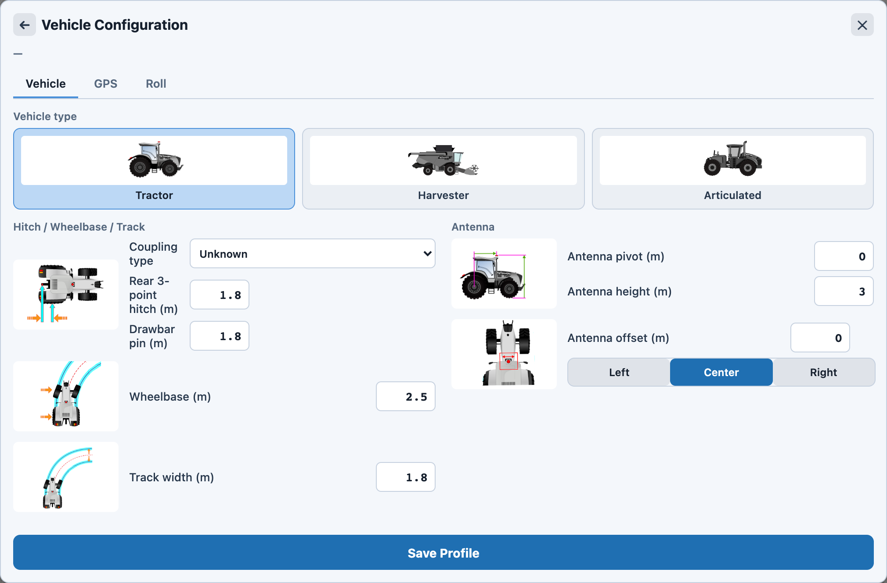
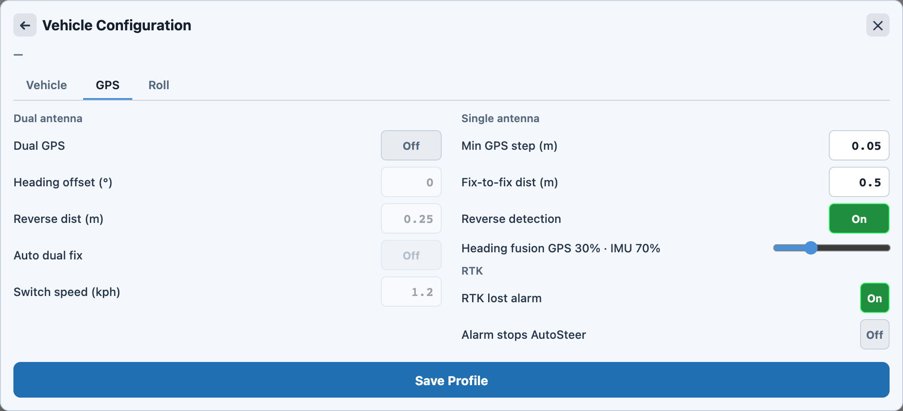
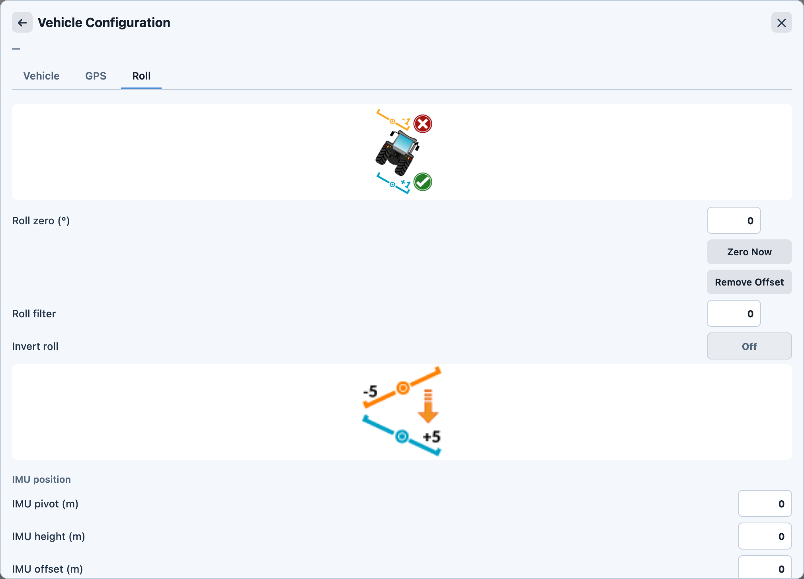

Open **Vehicle & Tool** on the left bar, select the vehicle, and tap
**Configure Vehicle…**. The panel has three tabs: **Vehicle**, **GPS** and
**Roll**.

A change works at once. Tap **Save Profile** to keep it.

Lengths are shown in metric or imperial units, following the choice in App
Settings.

## Vehicle tab

### Vehicle type

**Tractor**, **Harvester** or **Articulated**. This decides how AgOpenWeb
works out the turn from the steering angle.

A harvester can only carry a front-mounted tool.

### Hitch

All three are measured from the centre of the rear axle. The picture changes
to show the one you are typing.

| Setting             | Measure                                                                         |
| ------------------- | ------------------------------------------------------------------------------- |
| Rear 3-point hitch  | Back to the pins at the end of the lower links                                  |
| Drawbar pin         | Back to the drawbar pin                                                         |
| Front 3-point hitch | Forward to the front lower-link pins. Shown only when the tool is front-mounted |

The tool's own length is added to these in its profile, so a tool profile
works behind any tractor: see [Tool](/software/setup/tool/#hitch).

**Coupling type** records the kind of hitch with the profile. It does not
change the guidance.

### Wheelbase and track width

- **Wheelbase**: from the centre of the front axle to the centre of the rear
  axle.
- **Track width**: from the centre of the left wheel to the centre of the
  right wheel.

### Antenna

These three matter most. A wrong antenna offset shows as passes that are too
wide apart going one way and too close going the other.

| Setting        | Measure                                                                                 |
| -------------- | --------------------------------------------------------------------------------------- |
| Antenna pivot  | From the rear axle forward to the antenna. Negative if the antenna is behind the axle   |
| Antenna height | From the ground up to the antenna                                                       |
| Antenna offset | From the centre line of the tractor sideways to the antenna, with **Left** or **Right** |

Choose **Center** if the antenna is on the centre line.

## GPS tab

### Dual antenna

| Setting        | What it does                                                                                                                |
| -------------- | --------------------------------------------------------------------------------------------------------------------------- |
| Dual GPS       | On when the receiver has two antennas and sends a heading from them                                                         |
| Heading offset | Degrees to add to the dual heading. Leave it at 0 if the offset is set in the receiver                                      |
| Reverse dist   | The distance travelled between checks of whether the tractor is going forwards or backwards                                 |
| Auto dual fix  | Above **Switch speed**, take the heading from the tractor's movement, steadied by the antennas, not from the antennas alone |
| Switch speed   | The speed for **Auto dual fix**                                                                                             |

If the heading is 90° or 180° wrong, see
[GPS receivers](/software/connect/gps-receivers/#if-the-heading-offset-is-wrong).

### Single antenna

With one antenna, the heading comes from the direction the tractor moves, and
from the IMU if there is one.

| Setting           | What it does                                                                                            |
| ----------------- | ------------------------------------------------------------------------------------------------------- |
| Min GPS step      | The tractor must move this far before a new position is used for the heading                            |
| Fix-to-fix dist   | The distance over which the direction of movement is measured. Longer is steadier and slower to respond |
| Reverse detection | Notice when the tractor backs up                                                                        |
| Heading fusion    | How fast the GPS corrects the IMU's heading. Further right trusts the GPS more                          |

These carry the AgOpenGPS values, and most tractors never need them changed.

### RTK

- **RTK lost alarm**: sound an alarm when the fix drops out of RTK.
- **Alarm stops AutoSteer**: also switch AutoSteer off when that happens.

## Roll tab

On a slope the cab leans, and the antenna on its roof moves downhill. The IMU
measures the lean so AgOpenWeb can work out where the wheels really are. For
that it must know what level is.

1. Tilt the tractor a little to the **right**, or watch the roll as you drive
   across a slope. The roll should read to the right. If it reads to the
   left, switch **Invert roll** on.
2. Park on **level ground**.
3. Tap **Zero Now**.

| Setting       | What it does                                               |
| ------------- | ---------------------------------------------------------- |
| Roll zero     | The offset in degrees. **Zero Now** fills it in            |
| Remove Offset | Sets the offset back to 0                                  |
| Roll filter   | Smooths the roll. 0 is none; higher is smoother and slower |
| Invert roll   | For an IMU that reads left when the tractor leans right    |

The same roll gauge and **Zero Roll** button are in **Tools**, under **Roll
Correction**, and in the [Steer Wizard](/software/setup/steer-wizard/).

### IMU position

Where the IMU sits, measured like the antenna: **IMU pivot** forward of the
rear axle (negative behind it), **IMU height** above the ground, and **IMU
offset** to the right of the centre line (negative to the left).

Leave all three at 0 if you have not measured them. AgOpenWeb does not use
them itself: it passes them to the modules, for a receiver whose own INS needs
to know where the IMU is, such as the UM981.
