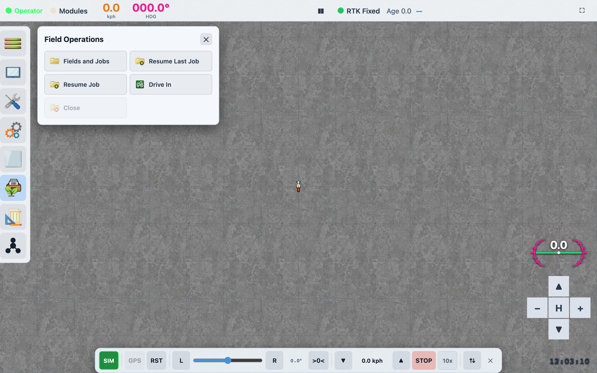
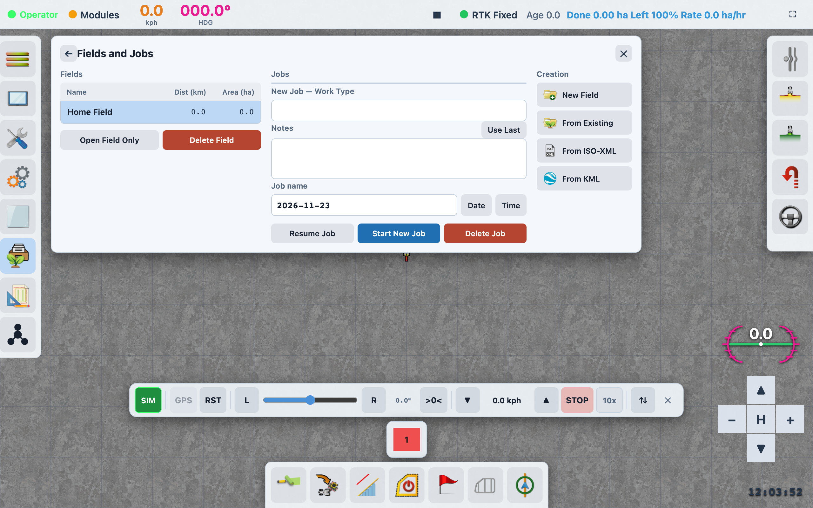
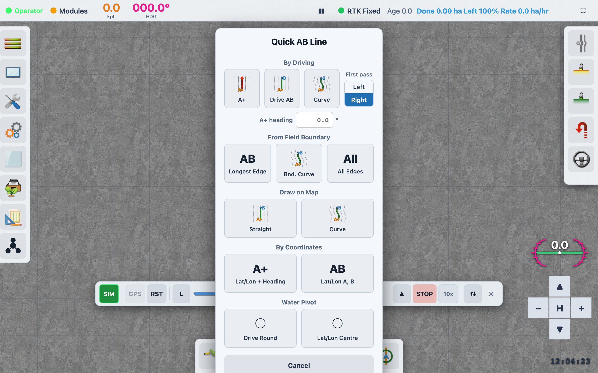
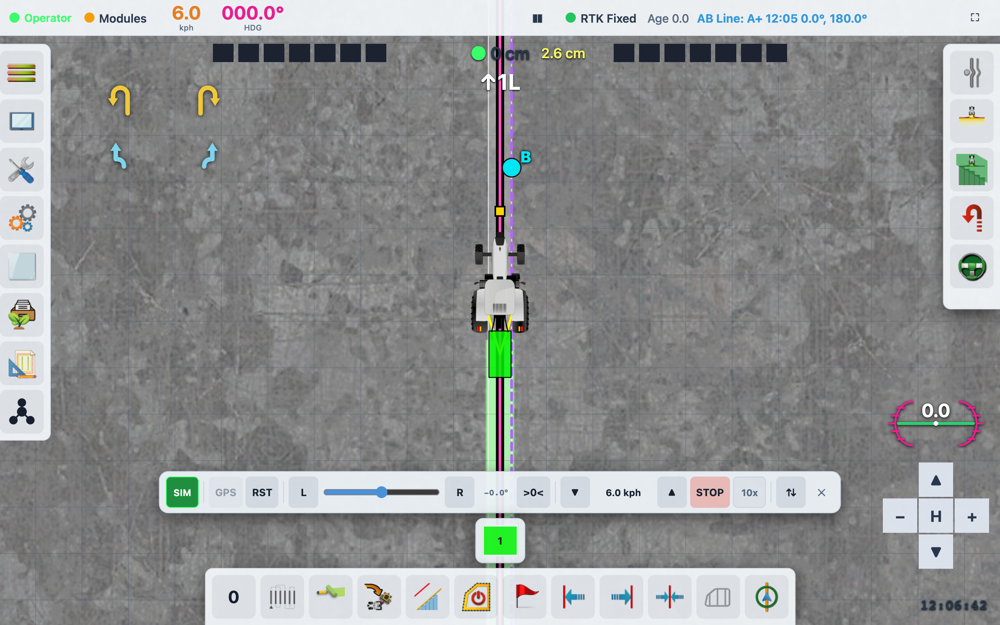

AgOpenWeb has a simulator built in: a pretend tractor with a pretend GPS that
you drive from the screen. Everything else is real. You make real fields, real
guidance lines and real settings, so it is the quickest way to learn the
program, and a safe place to try a setting before you use it in the field.

You need no hardware for this page. Ten minutes is enough.

:::note[The simulator never steers your tractor]
With the simulator on, AgOpenWeb does not send steering commands to the steer
module, even with AutoSteer engaged on the screen. Sections and the hydraulic
lift are still sent to the machine module, so you can bench-test a sprayer's
valves.
:::

## 1. Turn the simulator on

A new install starts with the simulator on. You can tell by the status bar: it
shows _RTK Fixed_ though no receiver is connected.

Tap the small **SIM** button at the bottom of the screen to open the simulator
bar.

If the simulator is off, the **SIM** button at the left of the bar turns it
on. You also find it under **File menu**, then **Simulator**.

## 2. Make a field

Guidance needs a field to work in.

1. On the left bar, tap **Field Operations** (the sixth button), then **Fields
   and Jobs**.

   

2. Tap **New Field**, type a name, and tap **Create Field**. The field is
   created where the tractor is standing.

   

3. Close the panel with **✕**. The new field is already open.

The guidance switches are now on the right and the field bar along the bottom.

## 3. Drive

On the simulator bar:

| Button                      | What it does                                   |
| --------------------------- | ---------------------------------------------- |
| **▲** and **▼**             | Faster and slower                              |
| **STOP**                    | Speed to zero                                  |
| **L**, **R** and the slider | Steer                                          |
| **>0<**                     | Steering back to straight ahead                |
| **10x**                     | Ten times as fast, for getting across a field  |
| **⇅**                       | Turn the tractor round to face the other way   |
| **RST**                     | Put the tractor back where it started          |
| **GPS**                     | Type in a latitude and longitude to start from |

Tap **▲** a few times to set off, and drive a little way from where you
started.

## 4. Make a guidance line

1. Tap the last button on the field bar, then **Quick AB**.

   

2. Tap **A+**. This makes a straight line through the tractor, in the
   direction it is facing.

The line appears on the map.

:::note
If you see _A+ needs a GPS position_, the tractor is still exactly where the
field was created. Drive forward a little and try again.
:::

## 5. Let it steer and switch

On the right bar:

1. Tap **AutoSteer** (the steering wheel, at the bottom). It turns green, and
   the tractor follows the line by itself.
2. Tap **Auto sections** (the third button). The section button at the bottom
   turns green and the ground behind the tool is painted as worked.

Steer off the line with **L** or **R**, let go, and watch it come back.

## 6. Things to try next

- **Turn at the end.** Tap one of the yellow arrows at the upper left of the
  map. The tractor makes a U-turn to that side and picks up the next pass.
- **Drive over worked ground.** Turn round onto a pass you have already
  painted: the section switches off by itself.
- **Change the tool.** A new install has a tool 1 metre wide with one section.
  Open **Vehicle & Tool** and give it your real width and sections, then watch
  the passes move apart.
- **Look around.** Tilt and zoom with the view controls at the lower right.
  See [A tour of the screen](/software/screen-tour/).

## When you are done

Close the field from **Field Operations**, then **Close**. The field and its
line are saved, and you can delete the field in **Fields and Jobs** if you do
not want to keep it.

When a real GPS receiver is connected and has a position, AgOpenWeb switches
the simulator off by itself, and AutoSteer goes off with it.
