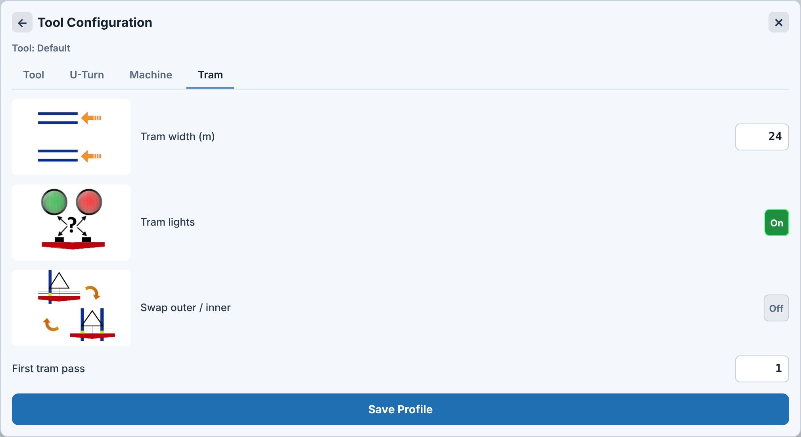
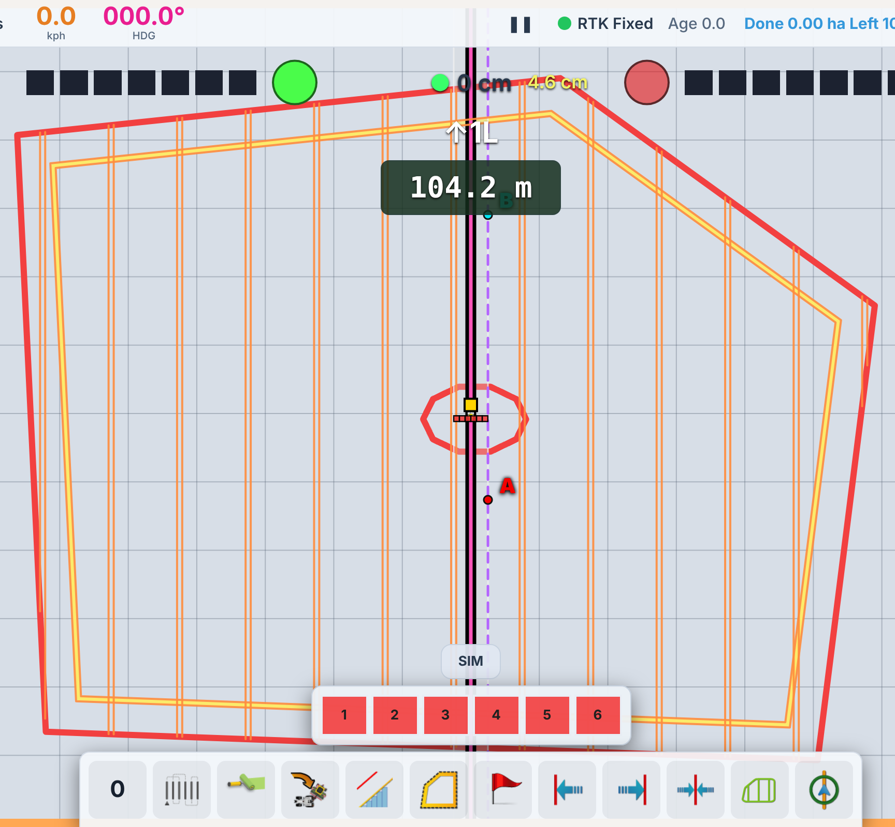
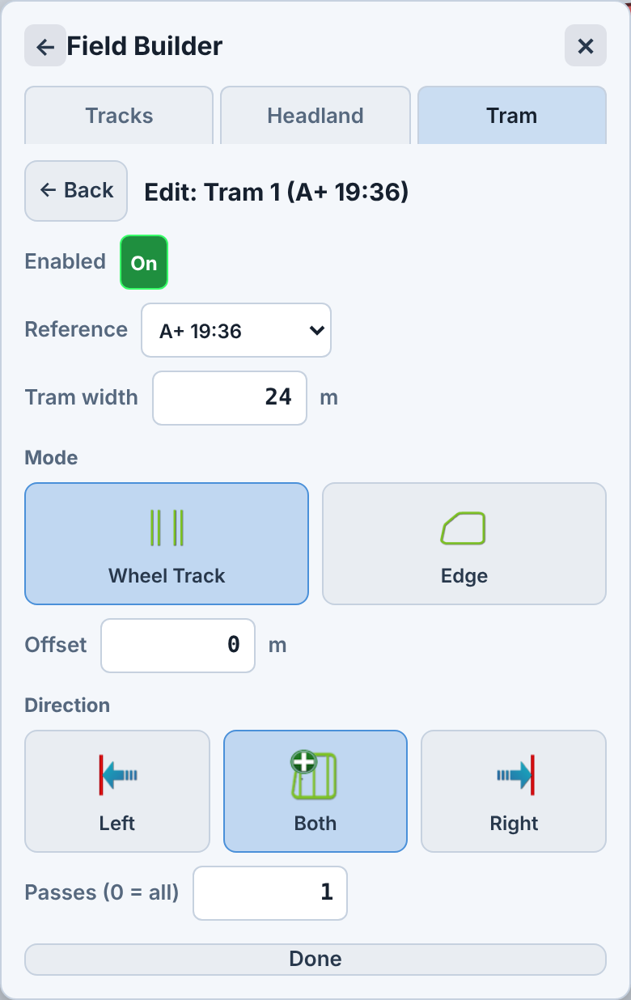

**Tram lines** are the wheel tracks left in a crop for the sprayer or the
spreader. While drilling, the seed drill shuts off the rows where those wheels
will run. AgOpenWeb draws the tram lines on the map, lights a lamp when one is
under the tool, and tells the
[machine module](/software/setup/machine-module/#pin-config) which side to
shut off.

Each tram line is a pair of lines, one for each wheel, the tractor's **Track
width** apart (see [Vehicle](/software/setup/vehicle/#wheelbase-and-track-width)).
The tram lines are one **tram width** apart: the working width of your sprayer.

## The tool's tram settings

Open **Vehicle & Tool** on the left bar, select the tool, tap **Configure
Tool…**, and choose the **Tram** tab.

| Setting            | What it does                                                                                    |
| ------------------ | ----------------------------------------------------------------------------------------------- |
| Tram width         | The space between tram lines: your sprayer's working width                                      |
| Tram lights        | Show the two tram lights beside the light bar. On also shows all the tram lines, Off hides them |
| Swap outer / inner | Check the wheels at the other place on the tool, see [below](#where-the-wheels-run)             |
| First tram pass    | Start the tram lines along a straight line further out, below                                   |

These settings belong to the tool. Tap **Save Profile** to keep them with it.

## Tram lines on the map

The tram lines are drawn in orange. To start with, AgOpenWeb lays them out by
itself:

- **Along a straight guidance line**: tram lines parallel to it, the first
  half a tram width from the line on each side, then one every tram width. One
  more goes round the field, half a tram width in from the boundary.
  **First tram pass** above 1 starts them one tram width further out for each
  step.
- **With a curve, or no line**: tram lines go round the inside of the
  boundary, one tram width apart.

A guidance line is kept at the edge of a pass (see
[Guidance lines](/software/guidance-lines/#by-driving)), so each tram line is
in the middle of a sprayer pass that starts at that edge. With the line along
the edge of the field, the first tram line is half a sprayer width in.

The **tram lines** button on the field bar, next to the guidance line menu,
steps through:

| Shows      | Which lines                                   |
| ---------- | --------------------------------------------- |
| Off        | None                                          |
| All        | All of them                                   |
| Lines only | Those across the field, not the ones round it |
| Outer only | Only those round the boundary                 |

With no tram lines round the boundary, it only switches between **Off** and
**Lines only**.

The button does more than hide them: only the lines shown light the lamps and
reach the machine module. With **Off**, nothing is shut off.

## Tram systems: your own layout

To choose where the tram lines go, open **Field Tools**, **Field Builder**,
then the **Tram** tab, and tap **＋ Add**. A tram system belongs to the field.
Once a field has one, AgOpenWeb draws only the lines of its systems, not the
ones it lays out by itself. Delete them all, and those come back the next time
the field is opened.

A new system follows the guidance line in use, or the boundary if there is
none, with the tool's tram width. **Edit** changes it:

| Setting    | What it does                                                                                                                                               |
| ---------- | ---------------------------------------------------------------------------------------------------------------------------------------------------------- |
| Enabled    | Off keeps the system but draws none of its lines                                                                                                           |
| Reference  | The line it is laid out from: one of the field's tracks, or **(Boundary)**                                                                                 |
| Tram width | The space between its tram lines                                                                                                                           |
| Mode       | **Wheel Track**: the first tram line is on the reference. **Edge**: the reference is the edge of a sprayer pass, so the first is half a tram width from it |
| Offset     | Moves all its tram lines sideways, in metres                                                                                                               |
| Direction  | Tram lines on the **Left** of the reference, the **Right**, or **Both**, looking from A to B                                                               |
| Passes     | How many tram lines on each side. 0 fills the field                                                                                                        |

With **(Boundary)** as the reference, the tram lines go round the inside of the
boundary, and **Passes** is how many laps, at least one. **Edge** starts the
first lap half a tram width in from the boundary, **Wheel Track** on the
boundary itself. **Offset** and **Direction** don't apply.

You can have several systems in one field, for example one along the line and
one round the boundary. **Delete** removes the chosen one, after asking.

## The tram lights

With **Tram lights** on, two lamps sit left and right of the light bar:

- **Green**: that side of the tool is over a tram line.
- **Red**: it is not.
- **Flashing yellow**: you forced that side on. Tap a lamp to force it on, and
  again to let it go. Turning the tram lines **Off** lets both go.

The lamps show only while the tram lines are not **Off**, and only for a tool
wider than the tractor's track width. While the tool is in the headland, with
**Headland on/off** on, they stay off: the same moment the
[hydraulic lift](/software/setup/machine-module/#hydraulic-lift) raises it.

The machine module gets the same two signals. Give pins **TramLeft** and
**TramRight** on the tool's
[Pin Config](/software/setup/machine-module/#pin-config) tab to the outputs
that shut off the rows.

### Where the wheels run

AgOpenWeb checks two places on the tool for a tram line. Which two depends on
how many tool widths make a tram width:

- **An even number**, such as a 6 m drill and a 24 m sprayer: half a track
  width in from each edge of the tool. Each tram line is left by two passes,
  one wheel each.
- **An odd number**, such as an 8 m drill and a 24 m sprayer: half a track
  width each side of the tool's centre. One pass leaves both wheels of a tram
  line.

Turn on **Swap outer / inner** if your set-up needs the other one.
