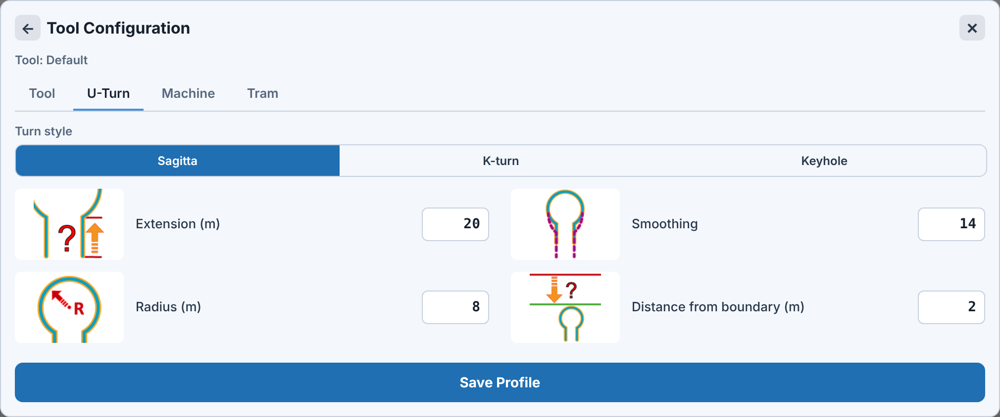

At the end of a pass AgOpenWeb can turn the tractor round onto the next pass
by itself, with AutoSteer doing the steering. You can also start a turn
yourself, at any point along the pass.

:::caution[You are still the driver]
A U-turn steers, but it does not brake, change gear or watch for people,
animals or a wet patch. Stay in the seat with your hands near the wheel, and
take over whenever the turn does not look right.
:::

## What a turn needs

- **A field with an outer boundary.** The turns are made inside it.
- **A guidance line**: an AB line or a curve. U-turns are not made on a closed
  track that goes round the field, or in contour mode.
- **AutoSteer engaged.** The turn is a path that AutoSteer follows.

## The turn line

AgOpenWeb draws a **turn line** inside the boundary, as far in as the
**Distance from boundary** setting says. A pass ends where it crosses the turn
line, and the turn is kept inside it.

The headland plays no part in the turn. It is for the sections, the hydraulic
lift and the drawing. If the headland is narrower than the turn is deep, the
turn starts before the headland line, with the sections still working. Widen
the headland or reduce the turn radius.

## Automatic U-turns

Tap **U-Turn** on the right bar to switch them on. While they are on, an
indicator at the upper right of the map shows what comes next:

- **Green**, with a distance: a turn is planned. The arrow points the way it
  will go, and the distance is how far ahead it starts.
- **Orange**, with no distance: no turn is planned at this end of the pass.

**Tap the arrow** to turn the other way. The first turn on a new line goes
towards the part of the field still to be worked, so you rarely need to.

About 20 m before the turn starts, AgOpenWeb sounds an alarm. **Screen &
Alerts**, **Alerts & Sounds**, **U-Turn** switches the sound on and off.

AutoSteer then drives the turn: out of the pass, round, and onto the next
pass, where line guidance takes over again. As soon as the turn starts, the
pass number and the highlighted line move to the pass it lands on.

If you back up during a turn, other than a K-turn, the turn is cancelled and
guidance stays on the pass you were on.

### Which pass it turns onto

Two buttons at the left of the field bar decide that.

**U-turn skip rows** is how many passes each turn jumps over. Tap it to step
from 0 to 9. At 0 the turn lands on the pass beside the one you are on.

**U-turn skip mode**:

| Mode               | What the turns do                                                                                                                       |
| ------------------ | --------------------------------------------------------------------------------------------------------------------------------------- |
| Normal             | Every turn jumps the same number of passes                                                                                              |
| Alternative        | The turns go out and back across the field, a long jump then one a pass shorter, so every turn is wide and every pass still gets worked |
| Skip worked tracks | Each turn goes to the nearest pass not yet worked, in the order planned for the field                                                   |

When no pass is left to work, a message near the bottom of the map says **End
of field reached**.

### Wide turns

When the next pass is more than twice the turn radius away, for a wide
spreader or with passes skipped, the turn goes out of the pass in a quarter
circle, runs along the turn line, and comes into the next pass in a quarter
circle. This keeps the distance from the boundary on a headland that is not
square to the passes.

## Manual U-turns

The two yellow arrows at the upper left of the map start a turn **now**, to
that side, onto the pass the skip setting picks. The turn starts at the
tractor, so you can turn in the middle of a field, or at an end where no
automatic turn was made.

A manual turn that would take the tractor out of the field, or the tool past a
hard boundary, is refused with **Not enough room — turn would put the tool
past the boundary**.

The arrows show only while AutoSteer is engaged. **Screen & Alerts**,
**On-Screen Buttons**, **U-Turn** hides them.

To stop a manual turn being started at speed, switch **Manual turns** on in
the AutoSteer panel's **Speed limits** tab and set **Manual turns speed**. A
tap on an arrow above that speed only shows **Too fast: slow down below**
that speed. It starts off, at 12 km/h.

## The U-Turn settings

Open **Vehicle & Tool**, **Configure Tool…**, then the **U-Turn** tab. The
settings belong to the tool profile. A change works at once. Tap **Save
Profile** to keep it.

### Turn style

| Style   | The turn                                                                                                                                                                                 |
| ------- | ---------------------------------------------------------------------------------------------------------------------------------------------------------------------------------------- |
| Sagitta | The default. One smooth loop that meets the next pass gently, with no sharp change in steering                                                                                           |
| Keyhole | Like Sagitta, but the loop is centred between the two passes. It needs less headland and swings less past the pass you are leaving                                                       |
| K-turn  | The tractor turns forwards most of the way round (about 125°), and the path ends inside the turn line. You stop and back up onto the next pass, and the turn ends as soon as you reverse |

### Sizes

| Setting                | What it does                                                                                                                          |
| ---------------------- | ------------------------------------------------------------------------------------------------------------------------------------- |
| Radius                 | The radius of the turn. Too small, and the tractor cannot follow it. It is not taken from the tractor's measurements: set it yourself |
| Distance from boundary | How far in from the boundary the turn line is. See below                                                                              |
| Extension              | How far the turn's path runs along the pass before the loop, and along the next pass after it                                         |
| Smoothing              | Smooths the manual U-turn. The automatic turn is always smoothed the same way, as in AgOpenGPS, and does not use it                   |

A new tool starts with a radius of 8 m, 2 m from the boundary, a 20 m
extension and a smoothing of 14.

**U-Turn Compensation** in the AutoSteer panel's **Algorithm** tab moves the
tractor's path through the turn out or in, if it runs wide or cuts in.

## Soft and hard boundaries

The field's outer boundary is **soft** unless you say otherwise. Open **Field
Tools**, then **Boundary**. The list shows each boundary with a **Hard**
column. Tap it on the outer boundary's row to switch between **Soft** and
**Hard**.

**Soft**: the turn keeps the **tractor** inside the turn line, as in
AgOpenGPS. A wide tool can swing out past it.

**Hard**: for a fence, a wall, a ditch or a row of trees. The turn keeps the
**tool** at least **Distance from boundary** away from the boundary. AgOpenWeb
follows each corner of the tool through the turn, using its width and its
**Implement length** from the [Tool page](/software/setup/tool/#hitch). If a
corner would come nearer than that, the turn is moved further into the field
and built again. If no turn fits, none is made, and you take over.

A manual U-turn cannot be moved in, because it starts at the tractor. If the
tool would swing past a hard boundary, the turn is refused.

:::tip[On a hard boundary, enter only the gap]
The tool's overhang is already counted. Enter the gap you want between the
tool and the fence, not the overhang plus the gap. Counting the overhang twice
moves turns in that would have fitted, or refuses them.
:::

## When no turn is made

AgOpenWeb says why in a message near the bottom of the map, with a sound, and
you take over at the end of the pass. The messages you will see most:

| Message                                                                                           | What it means                                                                                                                           |
| ------------------------------------------------------------------------------------------------- | --------------------------------------------------------------------------------------------------------------------------------------- |
| No U-turn onto the next pass: only 15 m of it at this end, 20 m needed                            | The next pass needs at least 20 m inside the field at this end, so AutoSteer can settle on it                                           |
| No U-turn onto the next pass: 16 m in, it runs 1.0 m from the boundary, 2.0 m needed              | The next pass runs along the boundary, closer than the distance from boundary                                                           |
| No U-turn fits inside the boundary at this end: the closest would come 0.8 m nearer the boundary… | No turn of this radius fits inside the turn line. Lower **Distance from boundary** by that much, reduce the **Radius**, or turn by hand |
| U-turn blocked: implement would swing into a hard boundary                                        | Even moved further into the field, no turn keeps the tool off the hard boundary                                                         |
| U-turn missed                                                                                     | The tractor was already too close to the boundary to turn, or left the turn's path near it. Take over                                   |
| End of field reached                                                                              | No pass is left to work                                                                                                                 |

You do not need to do anything after changing a setting: AgOpenWeb tries the
same end again every 1.5 seconds, and at once when you change the pass, the
nudge, the skip, the turn's direction or a U-turn setting.
